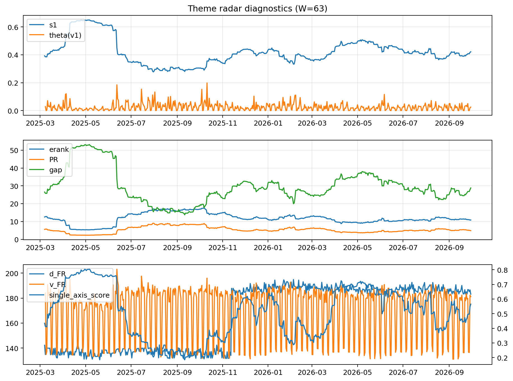

# Theme Radar Daily Brief — 2026-09-30

## Leaders (v1) — W=63
- **Nuclear_Uranium** (0.0793279440066812)
- Semis (0.0654523423507141)
- Quantum (0.0596321355785864)

## Challengers — W=63
**v2:** Genomics_Bio (0.0952972637806259), Semis (0.0789182298680989), Rates (0.0764469440847251)
**v3:** Software_Cloud (0.1052819332263622), Cyber (0.0676789459279693), Metals (0.0676155847767504)

## Migration (20D slope) — W=63
**Top risers:**
- axis_Rates: 0.0007580441300491
- axis_DataCenter_Infra: 0.0006614576502563
- axis_Sector_Utilities: 0.0003103893354722
- axis_Commodities: 0.0002932325772874
- axis_Credit: 0.000222384085674
- axis_Sector_RealEstate: 0.0001794668642961
- axis_Sector_ConsDisc: 0.0001471517211778
- axis_Sector_Materials: 0.000141894300874
- axis_Sector_Ind: 0.0001017790684006
- axis_Software_Cloud: 9.792537717047304e-05

**Top fallers:**
- axis_Space: -0.0001737575398236
- axis_Sector_Health: -0.0001815203886342
- axis_Sector_ConsStap: -0.0002092049953911
- axis_Cyber: -0.000214426644378
- axis_Quantum: -0.0002407201266795
- axis_Semis: -0.0002463244848564
- axis_Metals: -0.0002526465373477
- axis_Genomics_Bio: -0.0002855568105001
- axis_Nuclear_Uranium: -0.0003108715819187
- axis_Crypto: -0.0003951866414042

## Risk line (W=63)
- s1: 0.4216666962130987
- theta_v1: 0.0248905490530905
- v_FR: 181.17131559122373
- single_axis_score: 0.5650959860383944

## Interpretation
**Regime:** `theme_migration`

- Action: Tomorrow watchlist: Rates, DataCenter_Infra, Sector_Utilities, Commodities, Credit + v2_top1=Genomics_Bio
- Action: Hedge note: normal correlation stability.

- Percentiles (W=63 history): vfr_pct=0.53, theta_pct=0.58, s1_pct=0.60, score_pct=0.61.

---
**BUNDLE_ROOT_SHA256:** `d7a2e9132068641b2663b39ac75820f4bb024606363689f023afa8589602e2ec`
