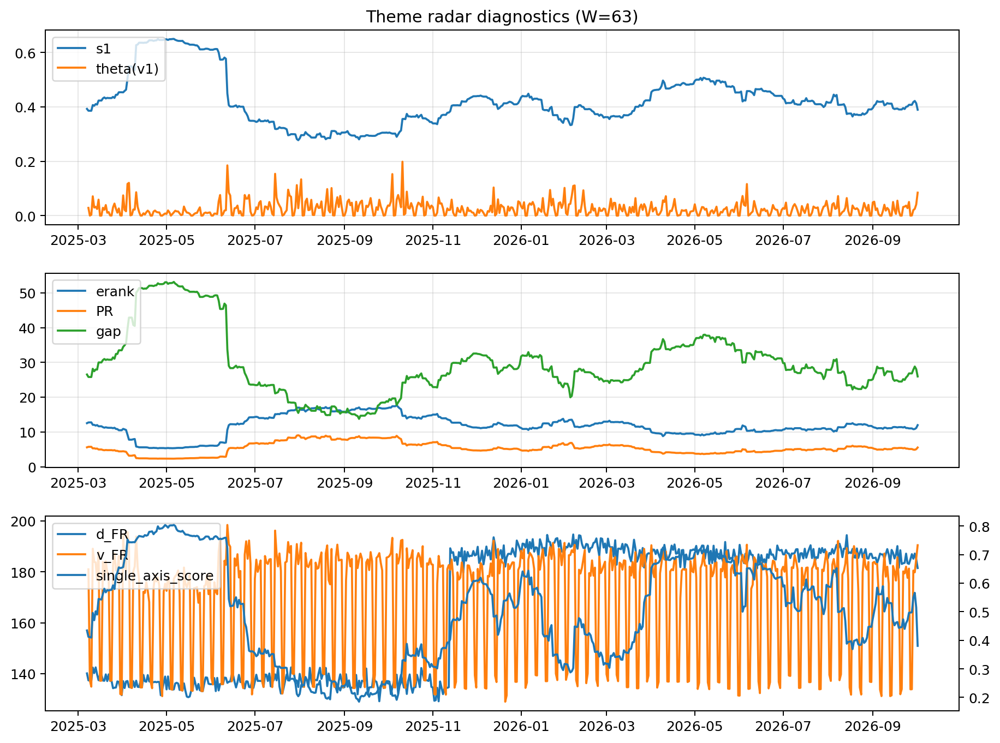

# Theme Radar Daily Brief — 2026-10-02

## Leaders (v1) — W=63
- **Nuclear_Uranium** (0.0762717040128044)
- Semis (0.0611237876238003)
- Quantum (0.0586321403150133)

## Challengers — W=63
**v2:** Genomics_Bio (0.0909415223314329), Semis (0.0846371278369711), Grid_Power (0.0775549836114437)
**v3:** Software_Cloud (0.1066148862415225), MegaCap_AI (0.0832525164038159), Semis (0.0697928695851513)

## Migration (20D slope) — W=63
**Top risers:**
- axis_Rates: 0.0009319482716697
- axis_DataCenter_Infra: 0.0006448091980874
- axis_Commodities: 0.0003080586901647
- axis_Sector_RealEstate: 0.0003045091998753
- axis_Sector_Utilities: 0.0002818913106872
- axis_Credit: 0.0002460963534321
- axis_Software_Cloud: 0.0002277496887281
- axis_Sector_ConsDisc: 0.0001678145777977
- axis_Sector_Materials: 0.0001656458420451
- axis_Sector_Ind: 7.775316234763013e-05

**Top fallers:**
- axis_Grid_Power: -0.0001634889345114
- axis_Drones_Autonomy: -0.0001862769807509
- axis_Metals: -0.0001932230600277
- axis_Genomics_Bio: -0.0002287794652509
- axis_Space: -0.0002445690129196
- axis_Sector_ConsStap: -0.0002532404037734
- axis_Crypto: -0.0002830788807081
- axis_Quantum: -0.0003065336786101
- axis_Semis: -0.0003661831241343
- axis_Nuclear_Uranium: -0.0003887362182414

## Risk line (W=63)
- s1: 0.3893940556983151
- theta_v1: 0.0845678635210436
- v_FR: 190.495085163408
- single_axis_score: 0.3805217391304348

## Interpretation
**Regime:** `structure_rewrite`

- Action: Tomorrow watchlist: Rates, DataCenter_Infra, Commodities, Sector_RealEstate, Sector_Utilities + v2_top1=Genomics_Bio
- Action: Hedge note: v_FR high + theta high → correlation structure unstable; diversify hedges / reduce reliance on static correlations.

- Percentiles (W=63 history): vfr_pct=0.96, theta_pct=0.96, s1_pct=0.37, score_pct=0.31.

---
**BUNDLE_ROOT_SHA256:** `ad224054785901bb2c4c3060431bfede5fdc818d70a22265f498cccce720df91`
