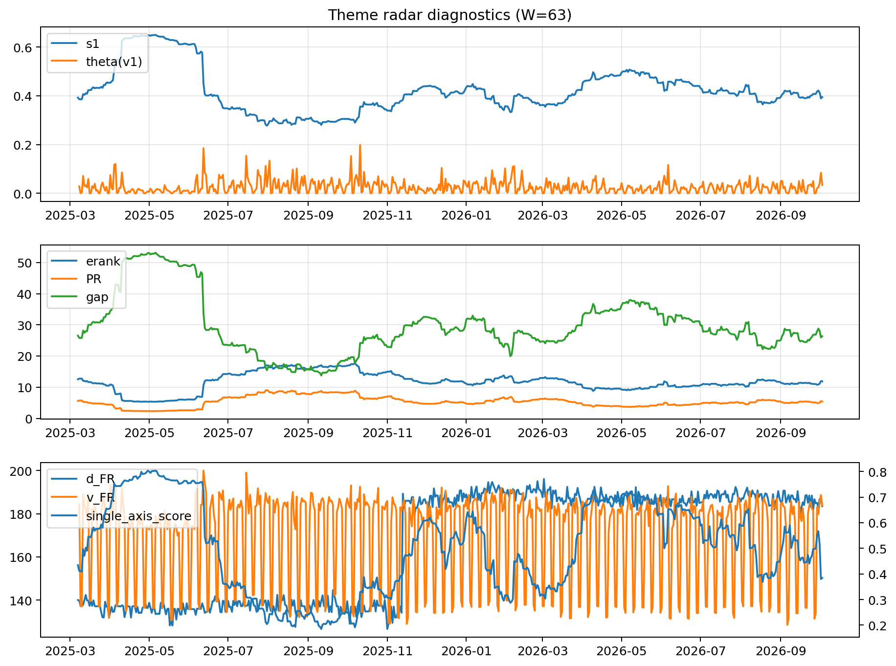

# Theme Radar Daily Brief — 2026-10-03

## Leaders (v1) — W=63
- **Nuclear_Uranium** (0.0749114057311816)
- Semis (0.0609071102084163)
- Space (0.0571010122502498)

## Challengers — W=63
**v2:** Semis (0.0973324637820186), Genomics_Bio (0.0820990885901441), Grid_Power (0.0765259295282226)
**v3:** Software_Cloud (0.0960547435955041), Metals (0.0739344525581018), Cyber (0.0675138331505366)

## Migration (20D slope) — W=63
**Top risers:**
- axis_Rates: 0.0009817282429841
- axis_DataCenter_Infra: 0.0006269718705004
- axis_Sector_RealEstate: 0.0003776148230511
- axis_Commodities: 0.0003186051130263
- axis_Software_Cloud: 0.0003001357828739
- axis_Sector_Utilities: 0.0002650799416575
- axis_Credit: 0.0002496264407677
- axis_Sector_ConsDisc: 0.0001963132418002
- axis_Sector_Materials: 0.0001891035392729
- axis_Sector_Comm: 0.0001039191194916

**Top fallers:**
- axis_Genomics_Bio: -0.0001740230650141
- axis_Metals: -0.0001755756517147
- axis_Crypto: -0.0002063254791137
- axis_Drones_Autonomy: -0.0002160058112819
- axis_Grid_Power: -0.0002385223037729
- axis_Space: -0.000277798023648
- axis_Sector_ConsStap: -0.0002866455350446
- axis_Quantum: -0.0003603870519728
- axis_Semis: -0.0004390386236938
- axis_Nuclear_Uranium: -0.0004702085800043

## Risk line (W=63)
- s1: 0.3945537820585094
- theta_v1: 0.0339494999187138
- v_FR: 183.95625973455876
- single_axis_score: 0.384375

## Interpretation
**Regime:** `theme_migration`

- Action: Tomorrow watchlist: Rates, DataCenter_Infra, Sector_RealEstate, Commodities, Software_Cloud + v2_top1=Semis
- Action: Hedge note: normal correlation stability.

- Percentiles (W=63 history): vfr_pct=0.70, theta_pct=0.74, s1_pct=0.40, score_pct=0.31.

---
**BUNDLE_ROOT_SHA256:** `81004dcd28f880f7aac7279ba9884c24b55b59fcc121e2a6ab0976ae3eb35bdb`
