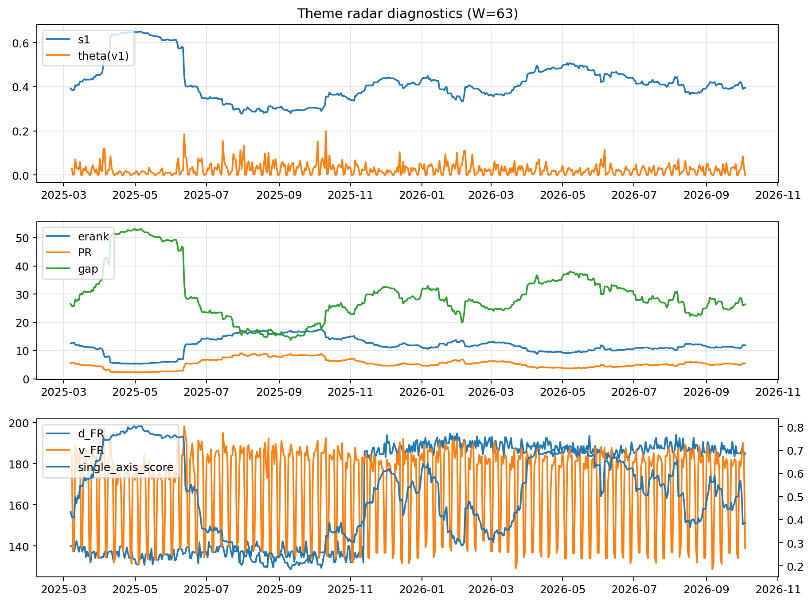

# Theme Radar Daily Brief — 2026-10-04

## Leaders (v1) — W=63
- **Nuclear_Uranium** (0.0749110529136374)
- Semis (0.0609044985713517)
- Space (0.0570990766451823)

## Challengers — W=63
**v2:** Semis (0.0973311154225164), Genomics_Bio (0.082081309225772), Grid_Power (0.0765067779117267)
**v3:** Software_Cloud (0.0960921697577971), Metals (0.0739066334961886), Cyber (0.0675361311881421)

## Migration (20D slope) — W=63
**Top risers:**
- axis_Rates: 0.0010079647642842
- axis_DataCenter_Infra: 0.0005919732906879
- axis_Sector_RealEstate: 0.0004402888321062
- axis_Software_Cloud: 0.0003651595878084
- axis_Commodities: 0.0003226267673092
- axis_Credit: 0.0002468246888675
- axis_Sector_Utilities: 0.0002392691388988
- axis_Sector_ConsDisc: 0.0002180775875154
- axis_Sector_Materials: 0.0002058037343322
- axis_Sector_Comm: 0.0001388484365265

**Top fallers:**
- axis_Clean_Broad: -0.0001265198951412
- axis_Metals: -0.00015337442757
- axis_Critical_Minerals: -0.0001701802327891
- axis_Drones_Autonomy: -0.0002390243537871
- axis_Space: -0.0003042500219665
- axis_Grid_Power: -0.0003072617415172
- axis_Sector_ConsStap: -0.0003098848852808
- axis_Quantum: -0.000404931874526
- axis_Semis: -0.0004994969244695
- axis_Nuclear_Uranium: -0.0005373118352597

## Risk line (W=63)
- s1: 0.3945576035816235
- theta_v1: 9.274485244227126e-05
- v_FR: 138.9031176697994
- single_axis_score: 0.3847487001733102

## Interpretation
**Regime:** `theme_migration`

- Action: Tomorrow watchlist: Rates, DataCenter_Infra, Sector_RealEstate, Software_Cloud, Commodities + v2_top1=Semis
- Action: Hedge note: normal correlation stability.

- Percentiles (W=63 history): vfr_pct=0.24, theta_pct=0.06, s1_pct=0.40, score_pct=0.32.

---
**BUNDLE_ROOT_SHA256:** `366c8baa6f11b3f935b4c60ba684bb39228e48a4bb0032dfd0d8eefb38992928`
