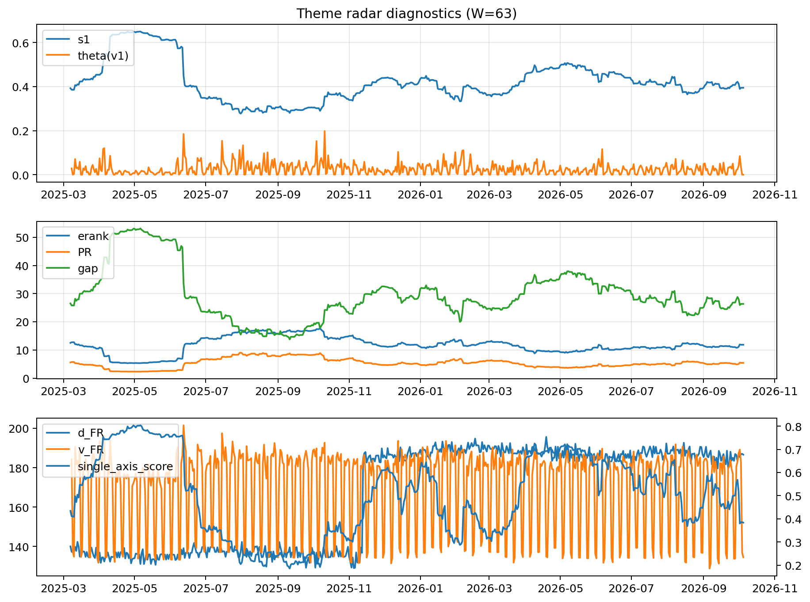

# Theme Radar Daily Brief — 2026-10-05

## Leaders (v1) — W=63
- **Nuclear_Uranium** (0.074912190412322)
- Semis (0.0609055186048753)
- Space (0.0571004828568986)

## Challengers — W=63
**v2:** Semis (0.0973385799952508), Genomics_Bio (0.082086867191981), Grid_Power (0.0765065824361161)
**v3:** Software_Cloud (0.0960972884609425), Metals (0.0739024492412604), Cyber (0.0675406329010495)

## Migration (20D slope) — W=63
**Top risers:**
- axis_Rates: 0.0009840255756013
- axis_DataCenter_Infra: 0.0005699852243185
- axis_Sector_RealEstate: 0.0004797912222645
- axis_Software_Cloud: 0.0003838978347246
- axis_Commodities: 0.0002905879643365
- axis_Credit: 0.0002309019034205
- axis_Sector_Utilities: 0.000228813976924
- axis_Sector_ConsDisc: 0.0002277739557611
- axis_Sector_Materials: 0.0002186807578643
- axis_Sector_Comm: 0.0001760166462415

**Top fallers:**
- axis_Metals: -0.0001157285899053
- axis_Clean_Broad: -0.0001310453888969
- axis_Critical_Minerals: -0.0001624978107627
- axis_Drones_Autonomy: -0.0002641053194471
- axis_Space: -0.000308661071202
- axis_Sector_ConsStap: -0.0003152436465218
- axis_Grid_Power: -0.0003347220607656
- axis_Quantum: -0.0004359040015583
- axis_Semis: -0.0005270823990561
- axis_Nuclear_Uranium: -0.0005792797679279

## Risk line (W=63)
- s1: 0.3945516643577892
- theta_v1: 0.0001925917147697
- v_FR: 134.53775649638925
- single_axis_score: 0.3833910034602076

## Interpretation
**Regime:** `theme_migration`

- Action: Tomorrow watchlist: Rates, DataCenter_Infra, Sector_RealEstate, Software_Cloud, Commodities + v2_top1=Semis
- Action: Hedge note: normal correlation stability.

- Percentiles (W=63 history): vfr_pct=0.11, theta_pct=0.10, s1_pct=0.40, score_pct=0.31.

---
**BUNDLE_ROOT_SHA256:** `5ec81004d9f96e893ef6a4e67a14c5fdcc8e9c5339a8d75ec9fbd608c44883f2`
