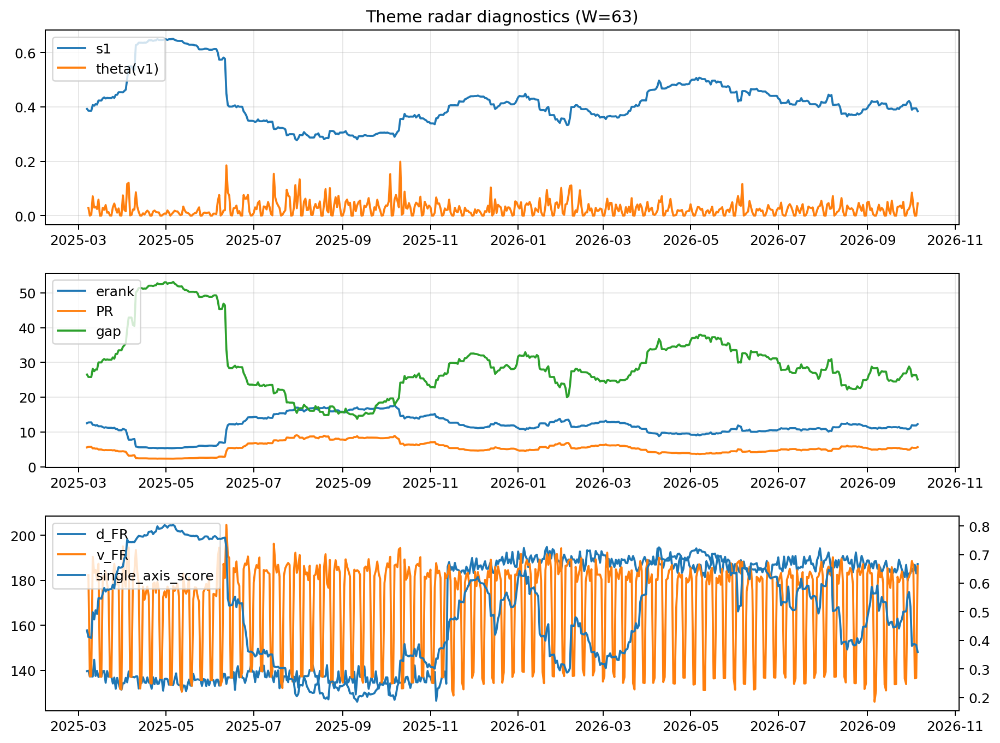

# Theme Radar Daily Brief — 2026-10-06

## Leaders (v1) — W=63
- **Nuclear_Uranium** (0.0741786011145135)
- Semis (0.0634533224508141)
- Space (0.0565264953143766)

## Challengers — W=63
**v2:** Semis (0.0949610537094426), Genomics_Bio (0.0795963088806992), Grid_Power (0.0780244950723657)
**v3:** Software_Cloud (0.1078315748208381), Cyber (0.0794331512666751), Space (0.0665138817791865)

## Migration (20D slope) — W=63
**Top risers:**
- axis_Rates: 0.0009351115648777
- axis_DataCenter_Infra: 0.0005645739034254
- axis_Sector_RealEstate: 0.0005036445053049
- axis_Software_Cloud: 0.0003740486128343
- axis_Commodities: 0.0002509316875808
- axis_Sector_ConsDisc: 0.0002265071228455
- axis_Sector_Materials: 0.000222182789192
- axis_Sector_Utilities: 0.000218478183399
- axis_Credit: 0.0002075365902344
- axis_Sector_Comm: 0.0001862374541002

**Top fallers:**
- axis_MegaCap_AI: -9.149237444383646e-05
- axis_Clean_Broad: -0.0001266032410944
- axis_Critical_Minerals: -0.0001327334744484
- axis_Drones_Autonomy: -0.0003091281049503
- axis_Space: -0.0003166203399549
- axis_Sector_ConsStap: -0.0003186253660467
- axis_Grid_Power: -0.0003583589114248
- axis_Quantum: -0.0004559747427176
- axis_Semis: -0.0005021246563179
- axis_Nuclear_Uranium: -0.00061215892504

## Risk line (W=63)
- s1: 0.384192914772343
- theta_v1: 0.0451082026017782
- v_FR: 186.2786258714982
- single_axis_score: 0.358894645941278

## Interpretation
**Regime:** `theme_migration`

- Action: Tomorrow watchlist: Rates, DataCenter_Infra, Sector_RealEstate, Software_Cloud, Commodities + v2_top1=Semis
- Action: Hedge note: normal correlation stability.

- Percentiles (W=63 history): vfr_pct=0.84, theta_pct=0.83, s1_pct=0.35, score_pct=0.28.

---
**BUNDLE_ROOT_SHA256:** `273b71d6b813d897f92c859a13f13cfe39571342869e67d48abcfd79a13abc83`
