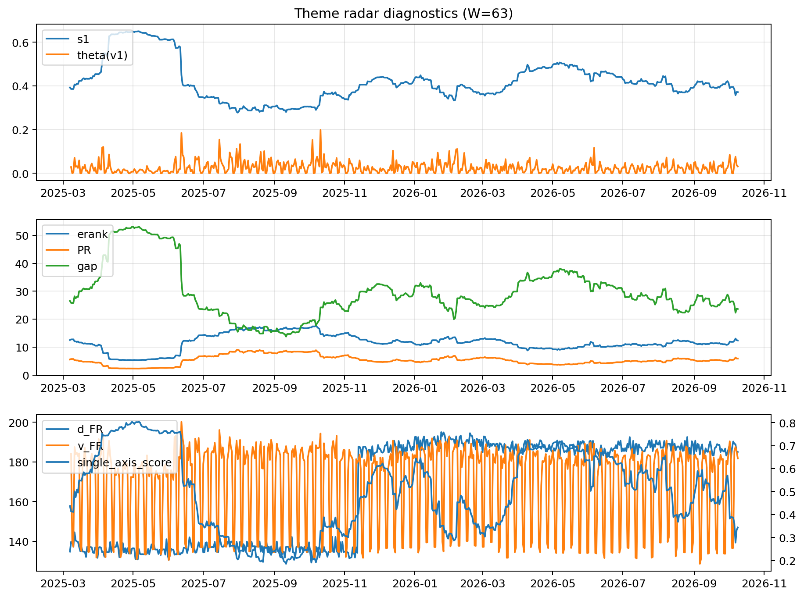

# Theme Radar Daily Brief — 2026-10-09

## Leaders (v1) — W=63
- **Nuclear_Uranium** (0.0784969842385276)
- Semis (0.0619183199318185)
- Space (0.0586828231329837)

## Challengers — W=63
**v2:** Semis (0.0959505742183783), Genomics_Bio (0.0827239117082041), Grid_Power (0.0726011836645735)
**v3:** Software_Cloud (0.1125642264529548), Cyber (0.0821215175799291), Space (0.0669721056810515)

## Migration (20D slope) — W=63
**Top risers:**
- axis_Rates: 0.0006731357638906
- axis_DataCenter_Infra: 0.0005533037468491
- axis_Sector_RealEstate: 0.0005453437609847
- axis_Sector_Utilities: 0.0002459707123642
- axis_Sector_ConsDisc: 0.0002449824148791
- axis_Crypto: 0.0002260965691241
- axis_Sector_Materials: 0.0002072600217867
- axis_Sector_Comm: 0.0001946044410155
- axis_Software_Cloud: 0.0001598676421731
- axis_Metals: 0.0001592638691666

**Top fallers:**
- axis_MegaCap_AI: -0.0001301015899267
- axis_Cyber: -0.0002030224649304
- axis_Genomics_Bio: -0.0002230775349718
- axis_Space: -0.000266540005951
- axis_Grid_Power: -0.0002911548276671
- axis_Sector_ConsStap: -0.0002952322073039
- axis_Drones_Autonomy: -0.0003775750019398
- axis_Quantum: -0.0004335211368675
- axis_Semis: -0.0004785590356709
- axis_Nuclear_Uranium: -0.000490923835048

## Risk line (W=63)
- s1: 0.3714101517826574
- theta_v1: 0.0313817972179959
- v_FR: 181.77341893173465
- single_axis_score: 0.3432989690721649

## Interpretation
**Regime:** `theme_migration`

- Action: Tomorrow watchlist: Rates, DataCenter_Infra, Sector_RealEstate, Sector_Utilities, Sector_ConsDisc + v2_top1=Semis
- Action: Hedge note: normal correlation stability.

- Percentiles (W=63 history): vfr_pct=0.57, theta_pct=0.69, s1_pct=0.31, score_pct=0.23.

---
**BUNDLE_ROOT_SHA256:** `bb7c482d0d48d4e09094bc9656f6c65e52a754475f65c59ea47c7958518fd59d`
