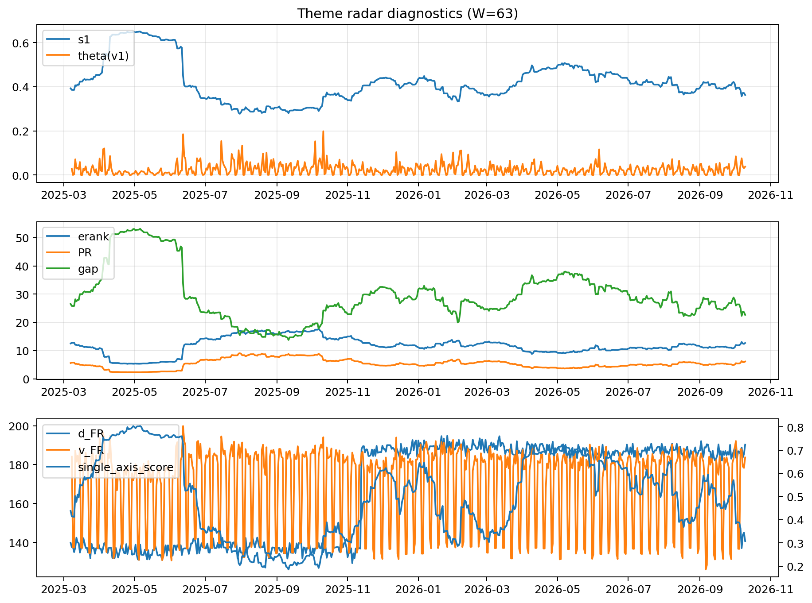

# Theme Radar Daily Brief — 2026-10-10

## Leaders (v1) — W=63
- **Nuclear_Uranium** (0.0774447008111285)
- Semis (0.061391555201378)
- Space (0.0572624709669022)

## Challengers — W=63
**v2:** Semis (0.0956090495010708), Genomics_Bio (0.0835682704455356), MegaCap_AI (0.0712765271269182)
**v3:** Software_Cloud (0.1135149875304903), Cyber (0.0804837748808429), Metals (0.0653358813872684)

## Migration (20D slope) — W=63
**Top risers:**
- axis_DataCenter_Infra: 0.0005623288957907
- axis_Sector_RealEstate: 0.00053029141124
- axis_Rates: 0.0005171628297307
- axis_Crypto: 0.0002779556551532
- axis_Sector_Utilities: 0.000246621034743
- axis_Sector_ConsDisc: 0.0002320833330771
- axis_Metals: 0.0002236530178879
- axis_Sector_Materials: 0.0001894530803975
- axis_Sector_Comm: 0.0001874389725557
- axis_USD: 0.0001016625188674

**Top fallers:**
- axis_MegaCap_AI: -0.0001075198612502
- axis_Grid_Power: -0.0002250546303388
- axis_Cyber: -0.0002294495857836
- axis_Space: -0.000246069223434
- axis_Genomics_Bio: -0.0002667291675707
- axis_Sector_ConsStap: -0.0002701910314786
- axis_Drones_Autonomy: -0.0003958417592223
- axis_Quantum: -0.0004124543114541
- axis_Nuclear_Uranium: -0.0004465185564859
- axis_Semis: -0.0004556687719897

## Risk line (W=63)
- s1: 0.3625007660124435
- theta_v1: 0.0376825972074234
- v_FR: 183.66406376841448
- single_axis_score: 0.3077186963979416

## Interpretation
**Regime:** `theme_migration`

- Action: Tomorrow watchlist: DataCenter_Infra, Sector_RealEstate, Rates, Crypto, Sector_Utilities + v2_top1=Semis
- Action: Hedge note: normal correlation stability.

- Percentiles (W=63 history): vfr_pct=0.68, theta_pct=0.77, s1_pct=0.25, score_pct=0.17.

---
**BUNDLE_ROOT_SHA256:** `f7d7c20eb0635cd472b300b96549e6460ad4ce22a9ea739ae6254b931c6683d6`
