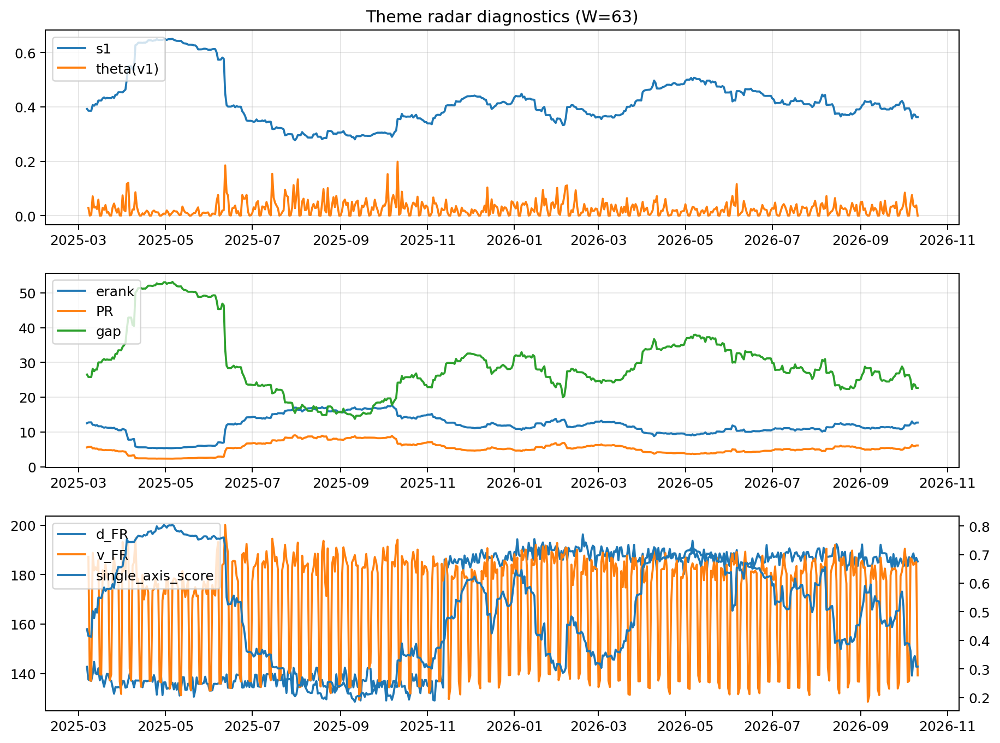

# Theme Radar Daily Brief — 2026-10-11

## Leaders (v1) — W=63
- **Nuclear_Uranium** (0.0774438282256047)
- Semis (0.0613893575498002)
- Space (0.057261231596608)

## Challengers — W=63
**v2:** Semis (0.0956163877793933), Genomics_Bio (0.0835613956334505), MegaCap_AI (0.0712769808613231)
**v3:** Software_Cloud (0.11352194567053), Cyber (0.0804883603349961), Metals (0.0653313528129866)

## Migration (20D slope) — W=63
**Top risers:**
- axis_DataCenter_Infra: 0.0005522639694327
- axis_Sector_RealEstate: 0.0005017471933744
- axis_Rates: 0.0003504267572663
- axis_Crypto: 0.000319378269792
- axis_Metals: 0.0002837236948212
- axis_Sector_Utilities: 0.0002404199819984
- axis_Sector_ConsDisc: 0.000213937515283
- axis_Sector_Comm: 0.0001793028293051
- axis_Sector_Materials: 0.0001686143439439
- axis_Vol: 0.0001082885658311

**Top fallers:**
- axis_Commodities: -0.0001378212277665
- axis_Grid_Power: -0.0001576004183507
- axis_Space: -0.0002188937772549
- axis_Sector_ConsStap: -0.0002400209720733
- axis_Cyber: -0.0002518235797109
- axis_Genomics_Bio: -0.0002988143885383
- axis_Quantum: -0.0003782655815049
- axis_Nuclear_Uranium: -0.000391713641192
- axis_Drones_Autonomy: -0.0004016428492749
- axis_Semis: -0.0004211567050804

## Risk line (W=63)
- s1: 0.3625072726512964
- theta_v1: 0.000100565212346
- v_FR: 139.26134588623546
- single_axis_score: 0.3082191780821918

## Interpretation
**Regime:** `theme_migration`

- Action: Tomorrow watchlist: DataCenter_Infra, Sector_RealEstate, Rates, Crypto, Metals + v2_top1=Semis
- Action: Hedge note: normal correlation stability.

- Percentiles (W=63 history): vfr_pct=0.24, theta_pct=0.07, s1_pct=0.25, score_pct=0.18.

---
**BUNDLE_ROOT_SHA256:** `f2109a607dce5623628b2528c1ec9260c6c98c31d3a8b5a7dc51ddffbec9738c`
