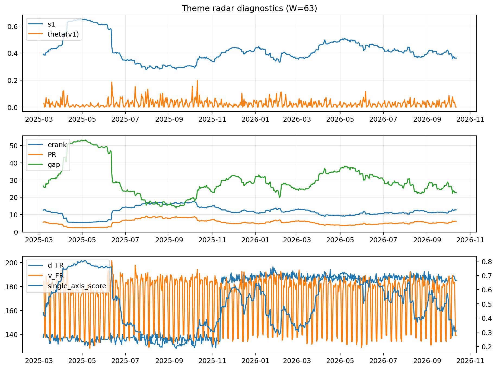

# Theme Radar Daily Brief — 2026-10-12

## Leaders (v1) — W=63
- **Nuclear_Uranium** (0.0774419364702085)
- Semis (0.0613842486944936)
- Space (0.0572585541914478)

## Challengers — W=63
**v2:** Semis (0.0956358179207994), Genomics_Bio (0.0835445884979276), MegaCap_AI (0.0712796392772071)
**v3:** Software_Cloud (0.1135395748986671), Cyber (0.0805001406426779), Metals (0.0653198488911943)

## Migration (20D slope) — W=63
**Top risers:**
- axis_DataCenter_Infra: 0.0005313234661895
- axis_Sector_RealEstate: 0.0004713168029019
- axis_Crypto: 0.0003850698051636
- axis_Metals: 0.0003110652063661
- axis_Sector_Utilities: 0.0002225896185084
- axis_Rates: 0.00019641995961
- axis_Sector_ConsDisc: 0.0001961029912374
- axis_Sector_Comm: 0.0001533276405822
- axis_Sector_Materials: 0.0001402876774489
- axis_Vol: 0.0001360675261362

**Top fallers:**
- axis_Defense: -0.00013628376238
- axis_Space: -0.0001859290120461
- axis_Commodities: -0.0002004779134898
- axis_Sector_ConsStap: -0.0002046468040656
- axis_Cyber: -0.0002547781669393
- axis_Genomics_Bio: -0.000327911323934
- axis_Nuclear_Uranium: -0.0003335027317723
- axis_Quantum: -0.0003396658197858
- axis_Semis: -0.0003759778815262
- axis_Drones_Autonomy: -0.0003993141404322

## Risk line (W=63)
- s1: 0.3625218690053648
- theta_v1: 0.0002291477443444
- v_FR: 139.0429788634903
- single_axis_score: 0.3087179487179486

## Interpretation
**Regime:** `theme_migration`

- Action: Tomorrow watchlist: DataCenter_Infra, Sector_RealEstate, Crypto, Metals, Sector_Utilities + v2_top1=Semis
- Action: Hedge note: normal correlation stability.

- Percentiles (W=63 history): vfr_pct=0.23, theta_pct=0.12, s1_pct=0.25, score_pct=0.18.

---
**BUNDLE_ROOT_SHA256:** `cb6fdbd8ffd21d47163e80f70a1dad9cf3d3515b962077309c6763b5aa6c59c4`
