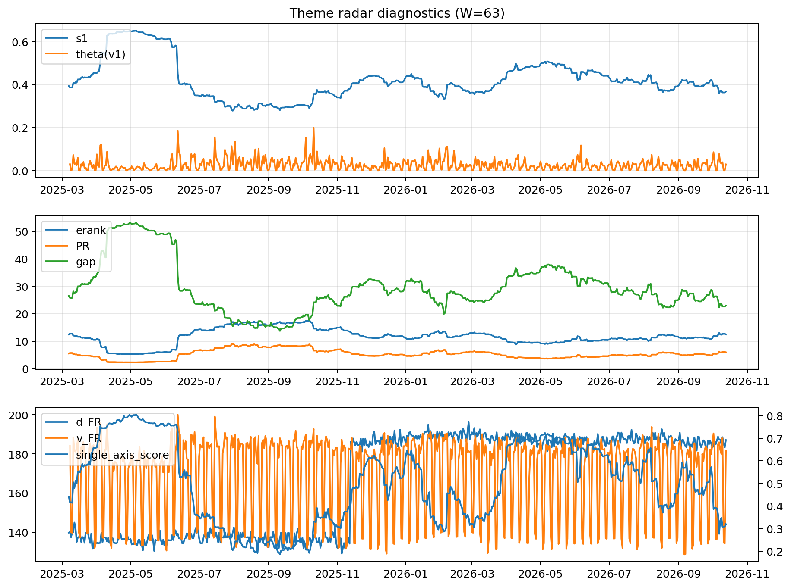

# Theme Radar Daily Brief — 2026-10-13

## Leaders (v1) — W=63
- **Nuclear_Uranium** (0.0777217973160071)
- Semis (0.0613759883909542)
- Space (0.0571332170726327)

## Challengers — W=63
**v2:** Semis (0.0947486895254339), Genomics_Bio (0.0786539480368029), MegaCap_AI (0.0726381068571759)
**v3:** Software_Cloud (0.1149328745061074), Cyber (0.0810102139030537), Metals (0.071286138279733)

## Migration (20D slope) — W=63
**Top risers:**
- axis_DataCenter_Infra: 0.0004604533667873
- axis_Crypto: 0.0004261749443834
- axis_Sector_RealEstate: 0.0004170236291973
- axis_Metals: 0.0003210790575163
- axis_Sector_Utilities: 0.0001871711804089
- axis_Sector_ConsDisc: 0.0001755579499638
- axis_Vol: 0.0001537171430152
- axis_Sector_Comm: 0.0001254907175489
- axis_Clean_Wind: 0.0001138296165512
- axis_Sector_Materials: 0.0001115935287127

**Top fallers:**
- axis_Space: -0.0001552555589255
- axis_Defense: -0.0001622722364236
- axis_Sector_ConsStap: -0.0001683985330396
- axis_Cyber: -0.0002073861571529
- axis_Commodities: -0.0002290895475196
- axis_Nuclear_Uranium: -0.0002826648951865
- axis_Quantum: -0.0002962637442295
- axis_Semis: -0.0003361136348063
- axis_Genomics_Bio: -0.0003446813862673
- axis_Drones_Autonomy: -0.0003887640370554

## Risk line (W=63)
- s1: 0.3666989225948545
- theta_v1: 0.0279419885794053
- v_FR: 181.60168169778632
- single_axis_score: 0.3191126279863481

## Interpretation
**Regime:** `theme_migration`

- Action: Tomorrow watchlist: DataCenter_Infra, Crypto, Sector_RealEstate, Metals, Sector_Utilities + v2_top1=Semis
- Action: Hedge note: normal correlation stability.

- Percentiles (W=63 history): vfr_pct=0.53, theta_pct=0.63, s1_pct=0.28, score_pct=0.19.

---
**BUNDLE_ROOT_SHA256:** `8a2d41e5b30095267cda3455d0b59acd67698199e35475933e21ebe998899f6f`
