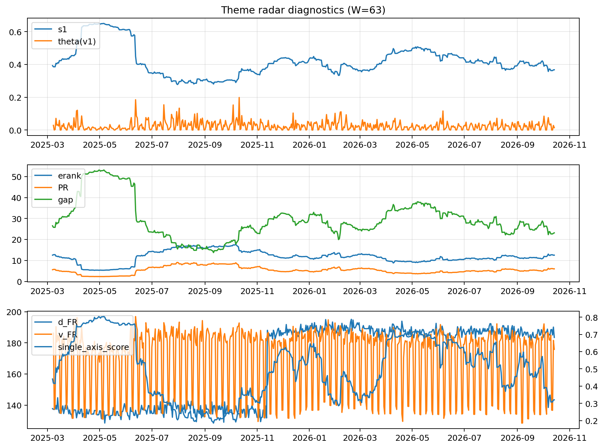

# Theme Radar Daily Brief — 2026-10-14

## Leaders (v1) — W=63
- **Nuclear_Uranium** (0.0775570000034267)
- Semis (0.0613103977785197)
- Space (0.057008337359994)

## Challengers — W=63
**v2:** Semis (0.0970928043438026), Genomics_Bio (0.0771209608981746), Rates (0.0731597682286145)
**v3:** Software_Cloud (0.1130303010778514), Cyber (0.080282568222031), Metals (0.0715085891458373)

## Migration (20D slope) — W=63
**Top risers:**
- axis_Crypto: 0.0004712031892749
- axis_DataCenter_Infra: 0.0003804354329065
- axis_Sector_RealEstate: 0.0003724675068478
- axis_Metals: 0.0003539285366211
- axis_Vol: 0.0001686617153288
- axis_Sector_Utilities: 0.0001656106476794
- axis_Sector_ConsDisc: 0.0001569461117019
- axis_Miners: 0.0001199244408502
- axis_Clean_Wind: 0.0001182829036145
- axis_Sector_Comm: 0.0001022921661919

**Top fallers:**
- axis_Space: -0.0001393578886356
- axis_Software_Cloud: -0.000145782238281
- axis_Cyber: -0.0001736425866846
- axis_Defense: -0.0001965407872331
- axis_Nuclear_Uranium: -0.0002322972994231
- axis_Commodities: -0.0002468675057341
- axis_Quantum: -0.0002803342816215
- axis_Semis: -0.0003088398989468
- axis_Genomics_Bio: -0.000326930855678
- axis_Drones_Autonomy: -0.0003804199340644

## Risk line (W=63)
- s1: 0.3673273730479992
- theta_v1: 0.0142512167018923
- v_FR: 175.81272503280894
- single_axis_score: 0.3202725724020443

## Interpretation
**Regime:** `theme_migration`

- Action: Tomorrow watchlist: Crypto, DataCenter_Infra, Sector_RealEstate, Metals, Vol + v2_top1=Semis
- Action: Hedge note: normal correlation stability.

- Percentiles (W=63 history): vfr_pct=0.34, theta_pct=0.40, s1_pct=0.28, score_pct=0.19.

---
**BUNDLE_ROOT_SHA256:** `267e6993f761775324fb9a0915f0fdf4fe8fc8f3764b7d07eca0a62c9a08e929`
