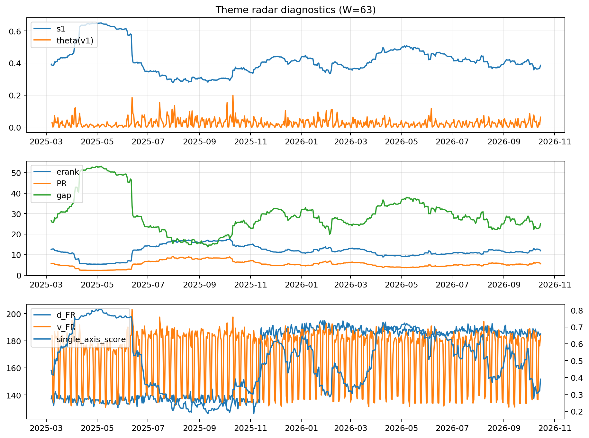

# Theme Radar Daily Brief — 2026-10-15

## Leaders (v1) — W=63
- **Nuclear_Uranium** (0.0786413494589041)
- Semis (0.0623041435575253)
- Space (0.057171617260466)

## Challengers — W=63
**v2:** Semis (0.0949668154059628), Rates (0.0849628364032857), Genomics_Bio (0.0820261020596249)
**v3:** Software_Cloud (0.1180681676396338), Cyber (0.0825186234546561), MegaCap_AI (0.0609862737839054)

## Migration (20D slope) — W=63
**Top risers:**
- axis_Crypto: 0.0005163472440299
- axis_Metals: 0.000370321426595
- axis_Sector_RealEstate: 0.0003157534149212
- axis_DataCenter_Infra: 0.0002958394859074
- axis_MegaCap_AI: 0.000201901153519
- axis_Vol: 0.0001800223532121
- axis_Sector_ConsDisc: 0.0001434281261976
- axis_Sector_Utilities: 0.0001401037679984
- axis_Clean_Wind: 0.0001258438150562
- axis_Miners: 0.0001242727271928

**Top fallers:**
- axis_Space: -0.0001178029264384
- axis_Software_Cloud: -0.0001234199765964
- axis_Nuclear_Uranium: -0.0001535578220897
- axis_Defense: -0.0002182049443309
- axis_Quantum: -0.0002570867727179
- axis_Rates: -0.0002573845465981
- axis_Semis: -0.0002608468865742
- axis_Commodities: -0.0002906109840023
- axis_Drones_Autonomy: -0.0003383919129793
- axis_Genomics_Bio: -0.0003559786997896

## Risk line (W=63)
- s1: 0.3860765292989411
- theta_v1: 0.0623785595903783
- v_FR: 183.61353231579707
- single_axis_score: 0.3901360544217687

## Interpretation
**Regime:** `theme_migration`

- Action: Tomorrow watchlist: Crypto, Metals, Sector_RealEstate, DataCenter_Infra, MegaCap_AI + v2_top1=Semis
- Action: Hedge note: normal correlation stability.

- Percentiles (W=63 history): vfr_pct=0.70, theta_pct=0.92, s1_pct=0.37, score_pct=0.33.

---
**BUNDLE_ROOT_SHA256:** `9a55bdf306c459707d113375c40cd608791a2f934422dfa5b3368027a2825241`
