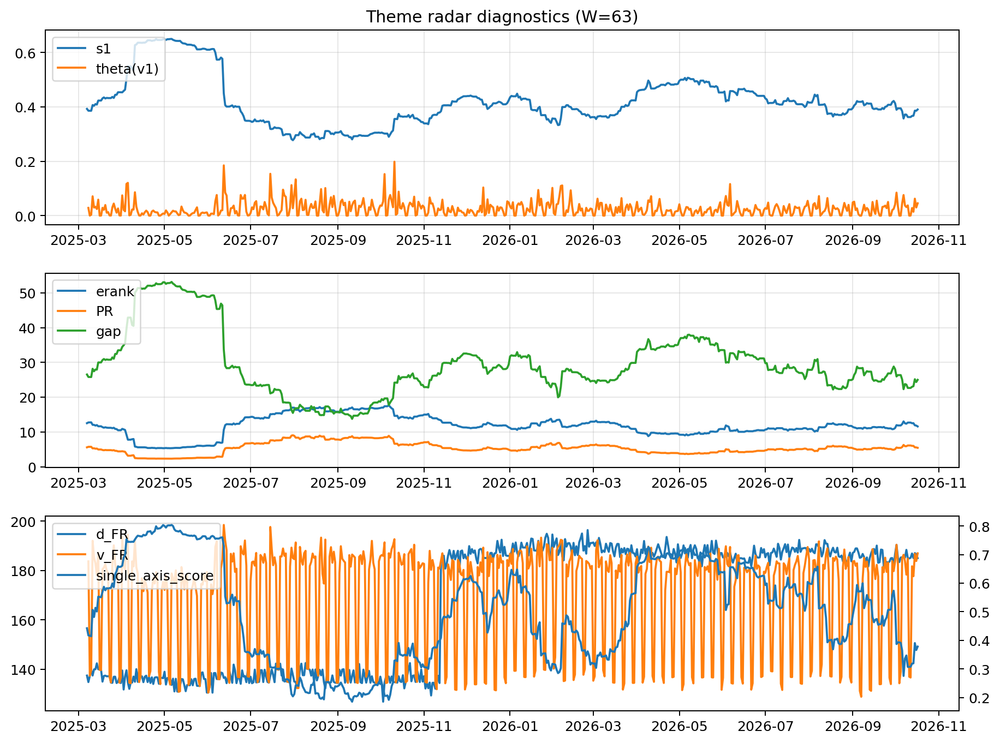

# Theme Radar Daily Brief — 2026-10-17

## Leaders (v1) — W=63
- **Nuclear_Uranium** (0.0787737546312128)
- Semis (0.0620624284006479)
- Quantum (0.0564425536202318)

## Challengers — W=63
**v2:** Semis (0.1038813971675392), Rates (0.0915496333535635), Genomics_Bio (0.0744889163838673)
**v3:** Software_Cloud (0.1069074761291954), Cyber (0.0733719795738871), Rates (0.0570169084528953)

## Migration (20D slope) — W=63
**Top risers:**
- axis_Crypto: 0.0005690764320694
- axis_Metals: 0.0004047899569975
- axis_MegaCap_AI: 0.0003910906978953
- axis_DataCenter_Infra: 0.0002684109074336
- axis_Sector_RealEstate: 0.0002245845653318
- axis_Vol: 0.0001902764150523
- axis_Critical_Minerals: 0.0001499611558086
- axis_Miners: 0.0001305278320657
- axis_Clean_Wind: 0.000115357869973
- axis_Sector_ConsDisc: 0.0001142809859262

**Top fallers:**
- axis_Sector_Fin: -9.714474978248484e-05
- axis_Space: -0.0001257231008818
- axis_Semis: -0.0001958540575944
- axis_Credit: -0.0002045454372407
- axis_Quantum: -0.0002211870860856
- axis_Defense: -0.0002450979971535
- axis_Drones_Autonomy: -0.0002554427221979
- axis_Commodities: -0.0003443009987825
- axis_Genomics_Bio: -0.0003947535640423
- axis_Rates: -0.0006109806701068

## Risk line (W=63)
- s1: 0.3903584119709742
- theta_v1: 0.0454340419738822
- v_FR: 186.94812589755932
- single_axis_score: 0.3783050847457627

## Interpretation
**Regime:** `theme_migration`

- Action: Tomorrow watchlist: Crypto, Metals, MegaCap_AI, DataCenter_Infra, Sector_RealEstate + v2_top1=Semis
- Action: Hedge note: normal correlation stability.

- Percentiles (W=63 history): vfr_pct=0.87, theta_pct=0.83, s1_pct=0.38, score_pct=0.32.

---
**BUNDLE_ROOT_SHA256:** `29e5ac8104bba030476a95d155cfc2c0f62047d98d2c58383e69f05742852835`
