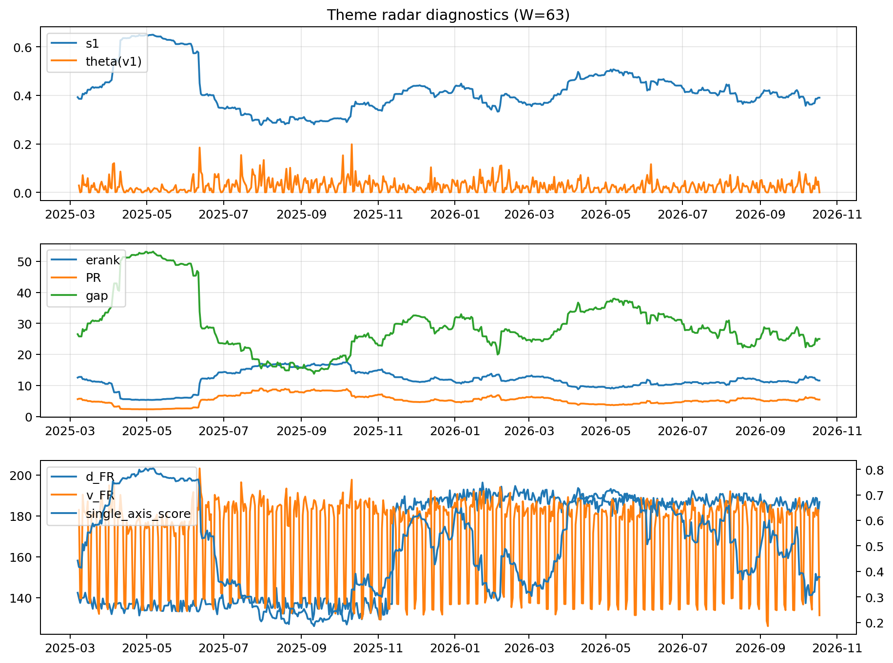

# Theme Radar Daily Brief — 2026-10-18

## Leaders (v1) — W=63
- **Nuclear_Uranium** (0.078776075204749)
- Semis (0.0620660278061913)
- Quantum (0.056444516161931)

## Challengers — W=63
**v2:** Semis (0.1038756903946752), Rates (0.0915511586771864), Genomics_Bio (0.0744923585156034)
**v3:** Software_Cloud (0.1069061747558269), Cyber (0.0733710066772499), Rates (0.0570187048585401)

## Migration (20D slope) — W=63
**Top risers:**
- axis_Crypto: 0.0005825277748726
- axis_MegaCap_AI: 0.0004800207128143
- axis_Metals: 0.0003986910512863
- axis_DataCenter_Infra: 0.0002412152371317
- axis_Vol: 0.0001892204516023
- axis_Sector_RealEstate: 0.0001628863917332
- axis_Critical_Minerals: 0.0001615179408516
- axis_Miners: 0.0001225973965365
- axis_Sector_ConsStap: 0.000119484940882
- axis_Cyber: 0.0001055817446025

**Top fallers:**
- axis_Sector_Fin: -9.58251307945137e-05
- axis_Space: -0.0001153842007551
- axis_Semis: -0.0001412419021137
- axis_Quantum: -0.0001915472221499
- axis_Drones_Autonomy: -0.0002068003914947
- axis_Credit: -0.0002435895732953
- axis_Defense: -0.0002574807193095
- axis_Commodities: -0.000354641645242
- axis_Genomics_Bio: -0.0003948882328993
- axis_Rates: -0.0007860371613286

## Risk line (W=63)
- s1: 0.3903425372557288
- theta_v1: 0.000235481140973
- v_FR: 131.32603275684474
- single_axis_score: 0.3780033840947546

## Interpretation
**Regime:** `theme_migration`

- Action: Tomorrow watchlist: Crypto, MegaCap_AI, Metals, DataCenter_Infra, Vol + v2_top1=Semis
- Action: Hedge note: normal correlation stability.

- Percentiles (W=63 history): vfr_pct=0.01, theta_pct=0.12, s1_pct=0.38, score_pct=0.32.

---
**BUNDLE_ROOT_SHA256:** `8c12ccc2e1bbbf685384275c5145c68f27bc6ab9948ae81d6fd186241212df17`
