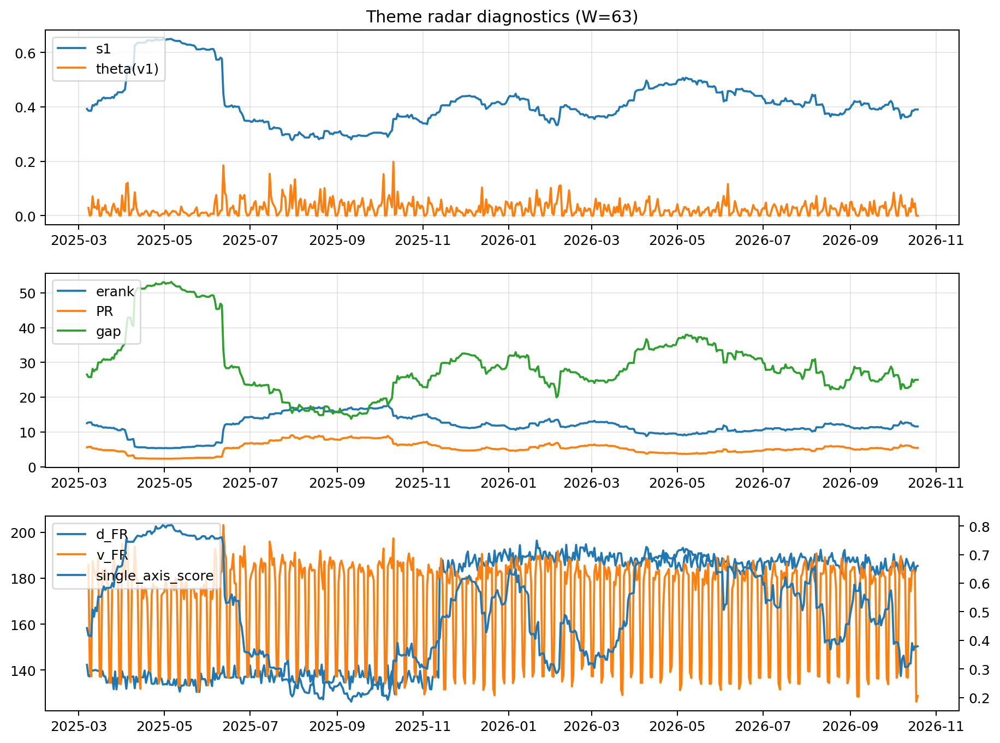

# Theme Radar Daily Brief — 2026-10-19

## Leaders (v1) — W=63
- **Nuclear_Uranium** (0.0787723942348804)
- Semis (0.0620605978160362)
- Quantum (0.0564416378854641)

## Challengers — W=63
**v2:** Semis (0.1038871109506962), Rates (0.0915560802868627), Genomics_Bio (0.0744852757203894)
**v3:** Software_Cloud (0.106911547350909), Cyber (0.0733746458882018), Rates (0.0570090618379818)

## Migration (20D slope) — W=63
**Top risers:**
- axis_Crypto: 0.0005850408989701
- axis_MegaCap_AI: 0.0005617099958244
- axis_Metals: 0.0003873100381963
- axis_DataCenter_Infra: 0.0002245568336412
- axis_Sector_ConsStap: 0.0001916131033246
- axis_Vol: 0.0001863738932505
- axis_Cyber: 0.0001689442277381
- axis_Critical_Minerals: 0.0001639877329239
- axis_Nuclear_Uranium: 0.0001332836208509
- axis_Grid_Power: 0.0001272335803422

**Top fallers:**
- axis_Sector_Materials: -8.409478114789227e-05
- axis_Sector_Fin: -8.874362650877055e-05
- axis_Space: -0.0001073579288255
- axis_Quantum: -0.0001427338990978
- axis_Drones_Autonomy: -0.0001525025655062
- axis_Defense: -0.000259448341816
- axis_Credit: -0.0002798927806936
- axis_Commodities: -0.0003559844856711
- axis_Genomics_Bio: -0.0004087174354514
- axis_Rates: -0.0009392197075991

## Risk line (W=63)
- s1: 0.3903691398956072
- theta_v1: 0.0003552406226024
- v_FR: 128.79472140353084
- single_axis_score: 0.3793918918918919

## Interpretation
**Regime:** `theme_migration`

- Action: Tomorrow watchlist: Crypto, MegaCap_AI, Metals, DataCenter_Infra, Sector_ConsStap + v2_top1=Semis
- Action: Hedge note: normal correlation stability.

- Percentiles (W=63 history): vfr_pct=0.01, theta_pct=0.14, s1_pct=0.38, score_pct=0.32.

---
**BUNDLE_ROOT_SHA256:** `ad4783810782caf4046d42ab8bc1f0ad2997fd2882197250fa864ba551a860b0`
