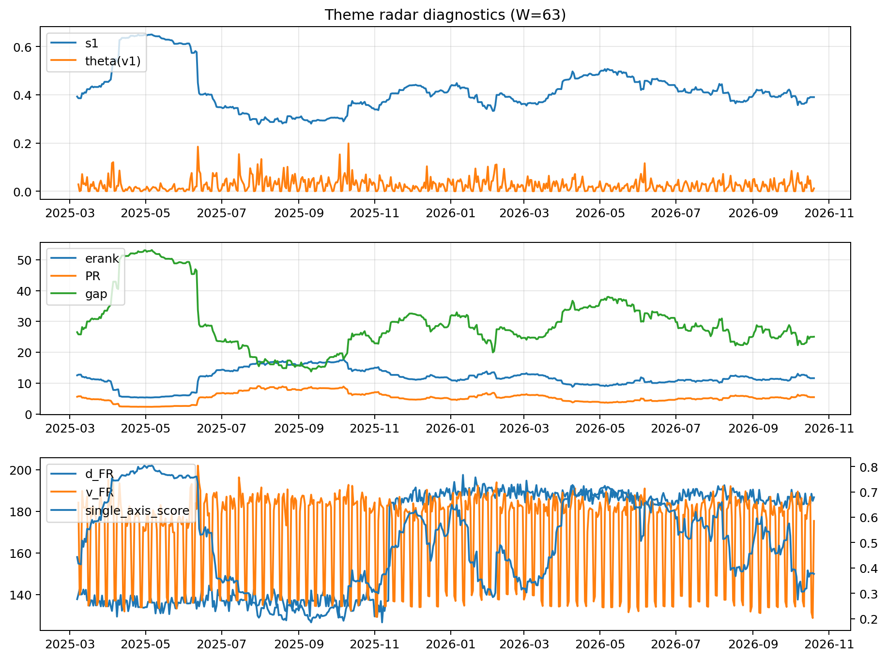

# Theme Radar Daily Brief — 2026-10-20

## Leaders (v1) — W=63
- **Nuclear_Uranium** (0.0786544498070227)
- Semis (0.0622281739268423)
- Quantum (0.0564638347912455)

## Challengers — W=63
**v2:** Semis (0.1019850963588478), Rates (0.0948904879011602), Genomics_Bio (0.0743712603051718)
**v3:** Software_Cloud (0.1019301364562852), Cyber (0.0668974534511217), DataCenter_Infra (0.0603501492628282)

## Migration (20D slope) — W=63
**Top risers:**
- axis_MegaCap_AI: 0.0006366079986371
- axis_Crypto: 0.0005706717141649
- axis_Metals: 0.0003556366933494
- axis_Sector_ConsStap: 0.0002566091370632
- axis_Cyber: 0.0002290430479991
- axis_DataCenter_Infra: 0.0001873318171408
- axis_Vol: 0.0001827334876315
- axis_Nuclear_Uranium: 0.0001799875571016
- axis_Critical_Minerals: 0.000158291618797
- axis_Grid_Power: 0.0001519295983208

**Top fallers:**
- axis_Equity_US: -7.541563182383015e-05
- axis_Drones_Autonomy: -9.418476840343836e-05
- axis_Quantum: -9.58280286839236e-05
- axis_Space: -0.0001061040605158
- axis_Sector_Materials: -0.0001063285649666
- axis_Defense: -0.0002515248476861
- axis_Credit: -0.0003027224248837
- axis_Commodities: -0.0003309119472257
- axis_Genomics_Bio: -0.0004065518092383
- axis_Rates: -0.0010542151402057

## Risk line (W=63)
- s1: 0.3902431441161759
- theta_v1: 0.0119900475212743
- v_FR: 175.39728492393948
- single_axis_score: 0.3767284991568296

## Interpretation
**Regime:** `theme_migration`

- Action: Tomorrow watchlist: MegaCap_AI, Crypto, Metals, Sector_ConsStap, Cyber + v2_top1=Semis
- Action: Hedge note: normal correlation stability.

- Percentiles (W=63 history): vfr_pct=0.33, theta_pct=0.37, s1_pct=0.38, score_pct=0.32.

---
**BUNDLE_ROOT_SHA256:** `34143e21c7a0afa5c9003e997ca60adc6cb638e0e0517e3e82d1bf8ae37fb7fa`
