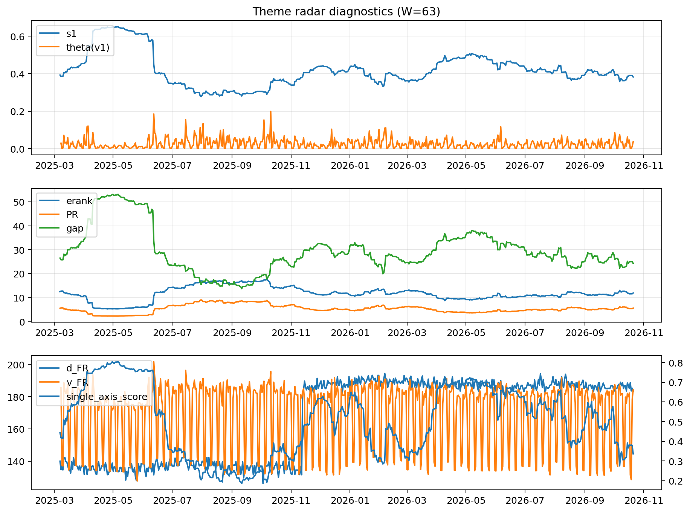

# Theme Radar Daily Brief — 2026-10-21

## Leaders (v1) — W=63
- **Nuclear_Uranium** (0.0778591212010177)
- Semis (0.0599621630892442)
- Quantum (0.0560197449500812)

## Challengers — W=63
**v2:** Semis (0.1042347368383292), Rates (0.0905336150682639), Genomics_Bio (0.0748093559076576)
**v3:** Software_Cloud (0.0992213328131097), Cyber (0.0655134605282499), DataCenter_Infra (0.0613826886616776)

## Migration (20D slope) — W=63
**Top risers:**
- axis_MegaCap_AI: 0.0006974993306946
- axis_Crypto: 0.0005468707637578
- axis_Metals: 0.0003381638479125
- axis_Sector_ConsStap: 0.0002993456834782
- axis_Cyber: 0.000286652472931
- axis_Software_Cloud: 0.0002299845817918
- axis_Nuclear_Uranium: 0.0002002506926561
- axis_Vol: 0.0001729582294419
- axis_Critical_Minerals: 0.0001603100955278
- axis_DataCenter_Infra: 0.00012823653447

**Top fallers:**
- axis_Equity_ExUS: -8.73173636786477e-05
- axis_Equity_US: -9.410671091695364e-05
- axis_Sector_Utilities: -0.0001063977728542
- axis_Space: -0.000117218587566
- axis_Sector_Materials: -0.0001336799547918
- axis_Defense: -0.0002479736277812
- axis_Credit: -0.0003020424129518
- axis_Commodities: -0.00030459792779
- axis_Genomics_Bio: -0.0003686147475685
- axis_Rates: -0.0010813554909066

## Risk line (W=63)
- s1: 0.3818321234482294
- theta_v1: 0.0367839388066149
- v_FR: 184.22103903134564
- single_axis_score: 0.336026936026936

## Interpretation
**Regime:** `theme_migration`

- Action: Tomorrow watchlist: MegaCap_AI, Crypto, Metals, Sector_ConsStap, Cyber + v2_top1=Semis
- Action: Hedge note: normal correlation stability.

- Percentiles (W=63 history): vfr_pct=0.74, theta_pct=0.75, s1_pct=0.35, score_pct=0.21.

---
**BUNDLE_ROOT_SHA256:** `88f77f1d00e5a366bf02d0e245e9aa65c44429170a5c7191687e723ad384db4f`
