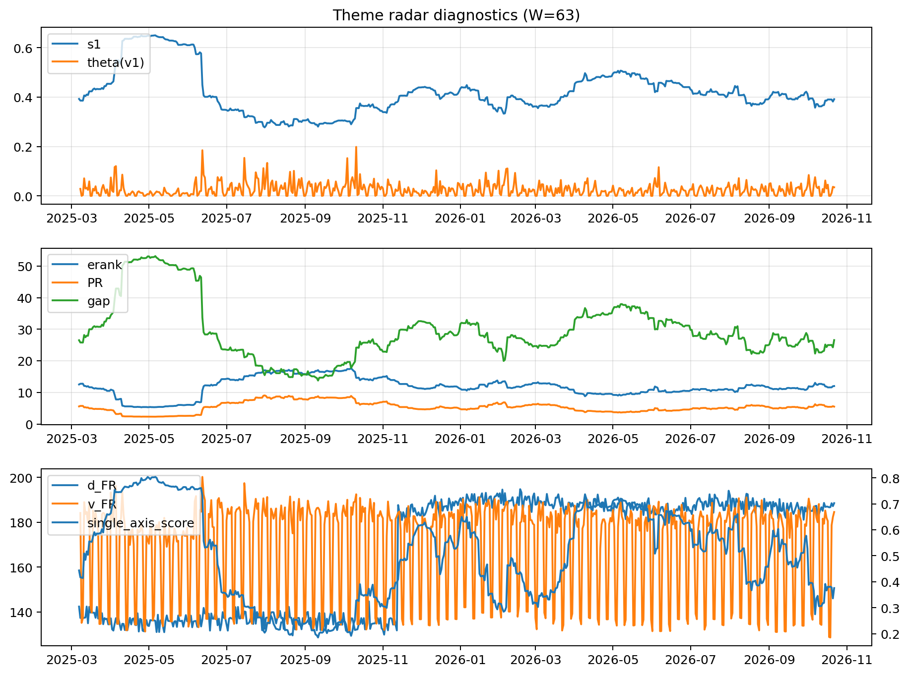

# Theme Radar Daily Brief — 2026-10-22

## Leaders (v1) — W=63
- **Nuclear_Uranium** (0.0768358590810175)
- Semis (0.0627990444327657)
- Quantum (0.0568221904424982)

## Challengers — W=63
**v2:** Rates (0.1107751281856909), Semis (0.1079086307641406), Space (0.055426150061198)
**v3:** Software_Cloud (0.0997633280623368), Grid_Power (0.066110604914569), Genomics_Bio (0.0655283830697743)

## Migration (20D slope) — W=63
**Top risers:**
- axis_MegaCap_AI: 0.0006635626618706
- axis_Crypto: 0.0005411789421481
- axis_Cyber: 0.0003565909604666
- axis_Software_Cloud: 0.0003535072445414
- axis_Sector_ConsStap: 0.0003058194220852
- axis_Metals: 0.0002958796477574
- axis_Nuclear_Uranium: 0.0001745112682506
- axis_Vol: 0.0001387814488068
- axis_Critical_Minerals: 0.000124370982862
- axis_DataCenter_Infra: 6.624493417584452e-05

**Top fallers:**
- axis_Equity_US: -0.0001059359728252
- axis_Space: -0.0001208045189887
- axis_Equity_ExUS: -0.0001213307469578
- axis_Sector_Utilities: -0.0001383110385097
- axis_Sector_Materials: -0.0001457899541703
- axis_Defense: -0.0002136035555845
- axis_Commodities: -0.0002535349944811
- axis_Credit: -0.0002852352804797
- axis_Genomics_Bio: -0.0002923390105194
- axis_Rates: -0.0010489939929717

## Risk line (W=63)
- s1: 0.3915188507970313
- theta_v1: 0.0349280092024486
- v_FR: 184.56749686255975
- single_axis_score: 0.3757983193277311

## Interpretation
**Regime:** `theme_migration`

- Action: Tomorrow watchlist: MegaCap_AI, Crypto, Cyber, Software_Cloud, Sector_ConsStap + v2_top1=Rates
- Action: Hedge note: normal correlation stability.

- Percentiles (W=63 history): vfr_pct=0.75, theta_pct=0.74, s1_pct=0.40, score_pct=0.32.

---
**BUNDLE_ROOT_SHA256:** `e306c389d6c0e53500a82ca7eab2ef0d8c390e56bea75d74ca68f9c70692c8fd`
