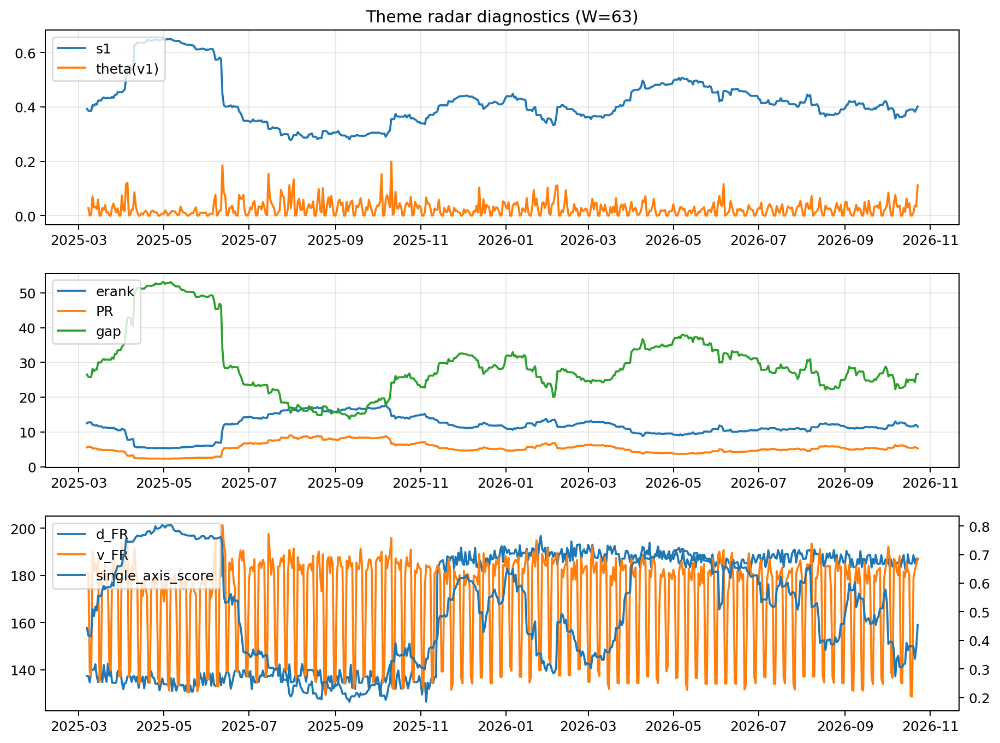

# Theme Radar Daily Brief — 2026-10-23

## Leaders (v1) — W=63
- **Nuclear_Uranium** (0.0770212462724892)
- Semis (0.06757349354521)
- Quantum (0.0571032899973184)

## Challengers — W=63
**v2:** Rates (0.1332847773470051), Semis (0.097584645822123), Credit (0.0586902484378384)
**v3:** Software_Cloud (0.1032620642902169), Cyber (0.0680028990618158), Crypto (0.0677959707512768)

## Migration (20D slope) — W=63
**Top risers:**
- axis_MegaCap_AI: 0.0007511529407673
- axis_Crypto: 0.000584949245034
- axis_Software_Cloud: 0.00045285601333
- axis_Cyber: 0.0004064158814117
- axis_Sector_ConsStap: 0.0003436207245024
- axis_Metals: 0.0002762826278158
- axis_Nuclear_Uranium: 0.0001290933968394
- axis_Critical_Minerals: 0.0001137711589793
- axis_Vol: 0.0001110495682984
- axis_Semis: 0.0001037438356123

**Top fallers:**
- axis_Sector_RealEstate: -0.0001150435424392
- axis_Equity_US: -0.0001206540715305
- axis_Equity_ExUS: -0.0001449970288063
- axis_Defense: -0.0001624836275254
- axis_Sector_Materials: -0.0001654030909444
- axis_Sector_Utilities: -0.0002040448379837
- axis_Commodities: -0.0002065129455964
- axis_Genomics_Bio: -0.000219482386206
- axis_Credit: -0.0003556528556774
- axis_Rates: -0.0012497244887101

## Risk line (W=63)
- s1: 0.4013216962541217
- theta_v1: 0.1111558405972463
- v_FR: 187.2503946965723
- single_axis_score: 0.4540268456375839

## Interpretation
**Regime:** `theme_migration`

- Action: Tomorrow watchlist: MegaCap_AI, Crypto, Software_Cloud, Cyber, Sector_ConsStap + v2_top1=Rates
- Action: Hedge note: normal correlation stability.

- Percentiles (W=63 history): vfr_pct=0.89, theta_pct=0.98, s1_pct=0.46, score_pct=0.41.

---
**BUNDLE_ROOT_SHA256:** `6199fde524ab67182039c370aa093470a641cb079aa4fb0fc5021695e5e954d2`
