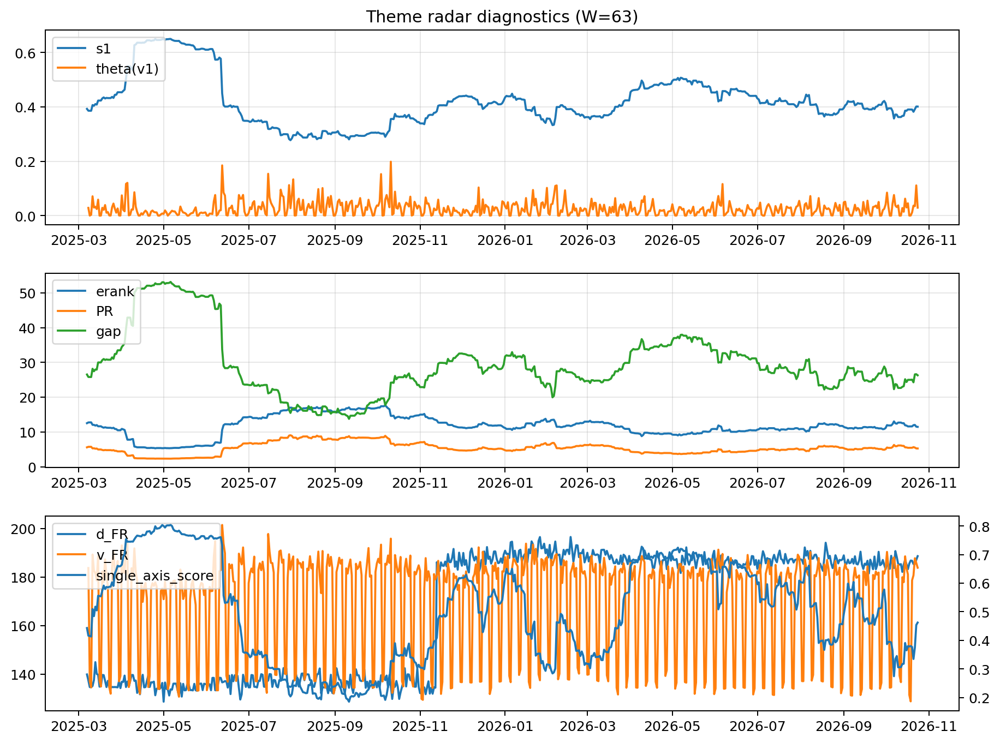

# Theme Radar Daily Brief — 2026-10-24

## Leaders (v1) — W=63
- **Nuclear_Uranium** (0.0776570957456201)
- Semis (0.0681442399276404)
- Quantum (0.0568591197078913)

## Challengers — W=63
**v2:** Rates (0.1352610925802087), Semis (0.0906959204908501), Credit (0.0588220632400157)
**v3:** Software_Cloud (0.1108808848673566), Grid_Power (0.0729966594443947), Cyber (0.0716445122534565)

## Migration (20D slope) — W=63
**Top risers:**
- axis_MegaCap_AI: 0.0008192586231728
- axis_Crypto: 0.000589531743198
- axis_Software_Cloud: 0.0005349449629526
- axis_Cyber: 0.0004403478444246
- axis_Sector_ConsStap: 0.0003721826279354
- axis_Metals: 0.000237122732532
- axis_Semis: 0.0001782335360168
- axis_Critical_Minerals: 0.00010849982942
- axis_Nuclear_Uranium: 8.958093179319304e-05
- axis_Vol: 7.635540897842308e-05

**Top fallers:**
- axis_USD: -0.0001209172737954
- axis_Equity_US: -0.0001352538402685
- axis_Commodities: -0.0001533801540684
- axis_Genomics_Bio: -0.0001592565224239
- axis_Sector_RealEstate: -0.0001618554385764
- axis_Equity_ExUS: -0.0001703427758186
- axis_Sector_Materials: -0.0001893801814435
- axis_Sector_Utilities: -0.0002444711518005
- axis_Credit: -0.0004081473591142
- axis_Rates: -0.0013816235166863

## Risk line (W=63)
- s1: 0.4010517113663989
- theta_v1: 0.0293369081980382
- v_FR: 183.78385093406712
- single_axis_score: 0.4623115577889446

## Interpretation
**Regime:** `theme_migration`

- Action: Tomorrow watchlist: MegaCap_AI, Crypto, Software_Cloud, Cyber, Sector_ConsStap + v2_top1=Rates
- Action: Hedge note: normal correlation stability.

- Percentiles (W=63 history): vfr_pct=0.72, theta_pct=0.65, s1_pct=0.46, score_pct=0.43.

---
**BUNDLE_ROOT_SHA256:** `a8b9494e7bbc359528163bea9175d5ca27248c68b7f90434d1f533f6c429b49d`
