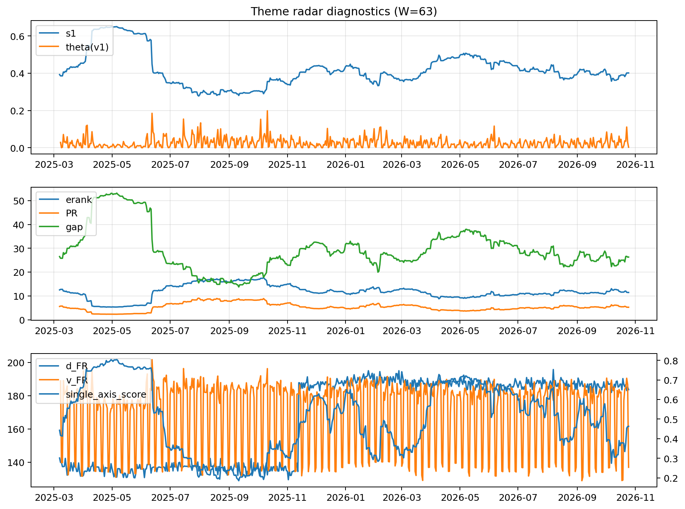

# Theme Radar Daily Brief — 2026-10-25

## Leaders (v1) — W=63
- **Nuclear_Uranium** (0.0776242650897324)
- Semis (0.0681119318646266)
- Quantum (0.0568379106507943)

## Challengers — W=63
**v2:** Rates (0.1352609790074763), Semis (0.0906890097678032), Credit (0.0588220316142489)
**v3:** Software_Cloud (0.1108614559026538), Grid_Power (0.0729900856880343), Cyber (0.0716279697943135)

## Migration (20D slope) — W=63
**Top risers:**
- axis_MegaCap_AI: 0.0008682861487613
- axis_Software_Cloud: 0.0006131239739254
- axis_Crypto: 0.0005776997215569
- axis_Cyber: 0.0004683470573648
- axis_Sector_ConsStap: 0.00038904587267
- axis_Semis: 0.0002413922237858
- axis_Metals: 0.0001872708806815
- axis_Critical_Minerals: 9.795554949583691e-05
- axis_Sector_Comm: 9.443115834100814e-05
- axis_Miners: 5.4936695626868754e-05

**Top fallers:**
- axis_Space: -0.0001013526836401
- axis_Robotics: -0.0001175104286492
- axis_USD: -0.0001421719118762
- axis_Equity_US: -0.0001458141019465
- axis_Equity_ExUS: -0.0001938616861322
- axis_Sector_RealEstate: -0.0002039715722125
- axis_Sector_Materials: -0.0002059971015852
- axis_Sector_Utilities: -0.0002806104846103
- axis_Credit: -0.0004464034473577
- axis_Rates: -0.0014701950872947

## Risk line (W=63)
- s1: 0.401283544921751
- theta_v1: 0.0025598490629537
- v_FR: 136.86989892018337
- single_axis_score: 0.4632107023411371

## Interpretation
**Regime:** `theme_migration`

- Action: Tomorrow watchlist: MegaCap_AI, Software_Cloud, Crypto, Cyber, Sector_ConsStap + v2_top1=Rates
- Action: Hedge note: normal correlation stability.

- Percentiles (W=63 history): vfr_pct=0.18, theta_pct=0.26, s1_pct=0.46, score_pct=0.43.

---
**BUNDLE_ROOT_SHA256:** `61e9dcd1420b157dbdba383bbb780c9baaf717174b0c032dc047213f694e91c5`
