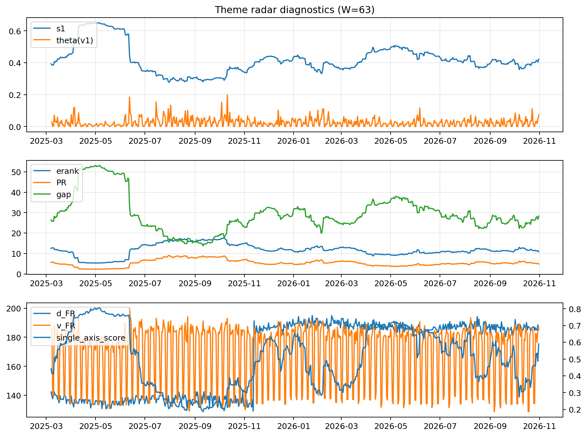

# Theme Radar Daily Brief — 2026-10-31

## Leaders (v1) — W=63
- **Nuclear_Uranium** (0.0796727917707253)
- Semis (0.0714914404400696)
- Space (0.0582153608322696)

## Challengers — W=63
**v2:** Rates (0.1485272583372751), Semis (0.0835635812576608), Credit (0.0591227442933341)
**v3:** Software_Cloud (0.1139387283219062), Crypto (0.0825757875578769), Grid_Power (0.0813842207867231)

## Migration (20D slope) — W=63
**Top risers:**
- axis_MegaCap_AI: 0.0005980719299315
- axis_Semis: 0.0005640082032334
- axis_Crypto: 0.0004921012592972
- axis_Software_Cloud: 0.000382717742076
- axis_Sector_ConsStap: 0.0003334349306442
- axis_Cyber: 0.0002615989411546
- axis_Grid_Power: 0.000191030832153
- axis_Critical_Minerals: 0.0001424507888058
- axis_Metals: 0.0001328856075255
- axis_Miners: 0.0001326253197276

**Top fallers:**
- axis_Drones_Autonomy: -7.829024153726054e-05
- axis_Clean_Broad: -0.0001533031233127
- axis_Equity_US: -0.0001542019180403
- axis_Equity_ExUS: -0.0001552545404472
- axis_Sector_Materials: -0.0002203478415306
- axis_USD: -0.0002286759961028
- axis_Sector_Utilities: -0.0002334861734783
- axis_Sector_RealEstate: -0.0003018031906848
- axis_Credit: -0.0004305839608106
- axis_Rates: -0.0015740139523665

## Risk line (W=63)
- s1: 0.4216782206386796
- theta_v1: 0.0737034677028416
- v_FR: 187.33161331449853
- single_axis_score: 0.5897350993377484

## Interpretation
**Regime:** `theme_migration`

- Action: Tomorrow watchlist: MegaCap_AI, Semis, Crypto, Software_Cloud, Sector_ConsStap + v2_top1=Rates
- Action: Hedge note: normal correlation stability.

- Percentiles (W=63 history): vfr_pct=0.89, theta_pct=0.95, s1_pct=0.62, score_pct=0.64.

---
**BUNDLE_ROOT_SHA256:** `ac1c2623165fb22367cec8e804bd41b169a1d421abb0c86e09e185102b2af204`
