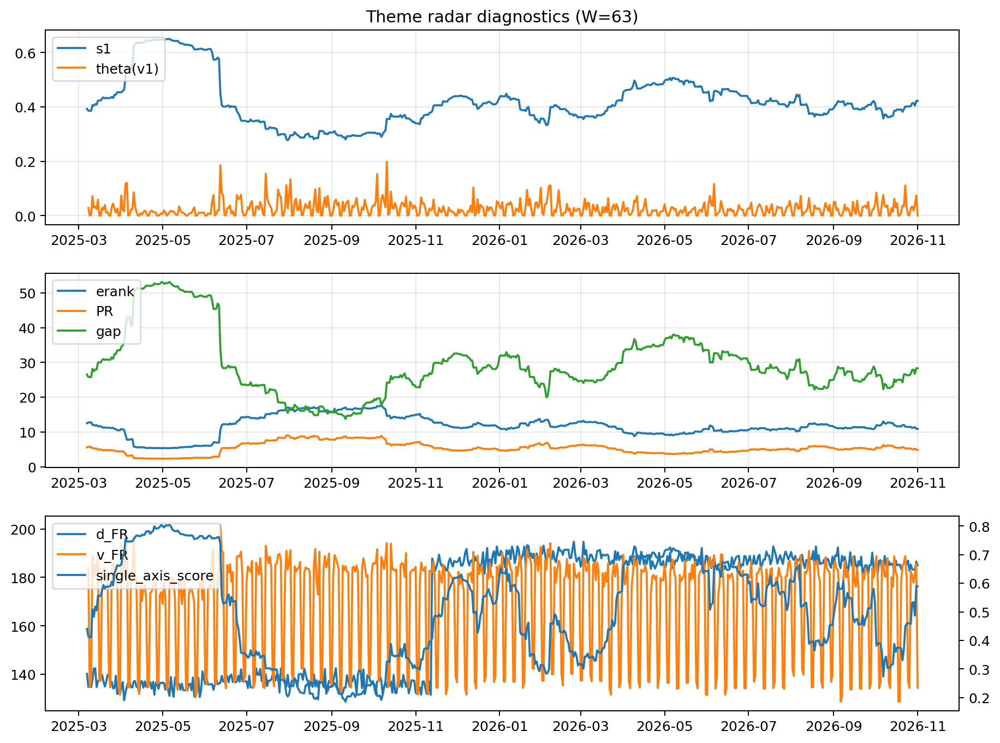

# Theme Radar Daily Brief — 2026-11-01

## Leaders (v1) — W=63
- **Nuclear_Uranium** (0.0796725877792618)
- Semis (0.0714918093508592)
- Space (0.0582155534905629)

## Challengers — W=63
**v2:** Rates (0.1485247093202432), Semis (0.0835602507784795), Credit (0.0591219755167812)
**v3:** Software_Cloud (0.1139363193492956), Crypto (0.0825918934117991), Grid_Power (0.0813797076954813)

## Migration (20D slope) — W=63
**Top risers:**
- axis_Semis: 0.0006060532387974
- axis_MegaCap_AI: 0.0005394532338789
- axis_Crypto: 0.0004411619294352
- axis_Sector_ConsStap: 0.0003070922674255
- axis_Software_Cloud: 0.0002902962719057
- axis_Grid_Power: 0.0002397131652432
- axis_Cyber: 0.0002015480005825
- axis_Metals: 0.0001430955734492
- axis_Miners: 0.0001405494037956
- axis_Critical_Minerals: 0.0001392151918887

**Top fallers:**
- axis_Drones_Autonomy: -9.923023491340028e-05
- axis_Equity_ExUS: -0.0001261421929479
- axis_Equity_US: -0.0001390813315066
- axis_Clean_Broad: -0.0001535388688617
- axis_Sector_Utilities: -0.0002172753152181
- axis_Sector_Materials: -0.0002194549061896
- axis_USD: -0.0002567386489311
- axis_Sector_RealEstate: -0.0003088549291697
- axis_Credit: -0.0004156424885969
- axis_Rates: -0.001611815864514

## Risk line (W=63)
- s1: 0.4216772901851052
- theta_v1: 1.4312865906684317e-05
- v_FR: 134.4199959186719
- single_axis_score: 0.5894214876033057

## Interpretation
**Regime:** `theme_migration`

- Action: Tomorrow watchlist: Semis, MegaCap_AI, Crypto, Sector_ConsStap, Software_Cloud + v2_top1=Rates
- Action: Hedge note: normal correlation stability.

- Percentiles (W=63 history): vfr_pct=0.09, theta_pct=0.01, s1_pct=0.62, score_pct=0.64.

---
**BUNDLE_ROOT_SHA256:** `e6ec299f69fb30ed6bc54aece5a3a3b1706b6f5c7928ea7e56f74d96421a0d82`
