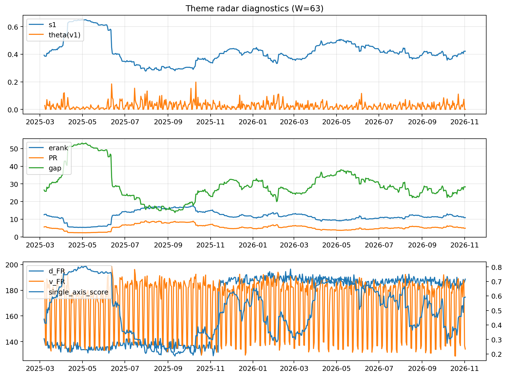

# Theme Radar Daily Brief — 2026-11-02

## Leaders (v1) — W=63
- **Nuclear_Uranium** (0.0796659408871317)
- Semis (0.0714794135627239)
- Space (0.0582056805934564)

## Challengers — W=63
**v2:** Rates (0.1485488546218238), Semis (0.0835764633896197), Credit (0.0591301691116762)
**v3:** Software_Cloud (0.1139343913460282), Crypto (0.0825259488025602), Grid_Power (0.0814311969052434)

## Migration (20D slope) — W=63
**Top risers:**
- axis_Semis: 0.0006325908946858
- axis_MegaCap_AI: 0.0004769356561541
- axis_Crypto: 0.0003817051764758
- axis_Sector_ConsStap: 0.0002803961564806
- axis_Grid_Power: 0.0002731014076425
- axis_Software_Cloud: 0.0002143046374384
- axis_Metals: 0.0001546639022805
- axis_Cyber: 0.0001543937492739
- axis_Critical_Minerals: 0.0001455125521379
- axis_Miners: 0.000144826905288

**Top fallers:**
- axis_Equity_ExUS: -9.823144841295618e-05
- axis_Drones_Autonomy: -0.0001050386112575
- axis_Equity_US: -0.0001291135847915
- axis_Clean_Broad: -0.0001536897812109
- axis_Sector_Utilities: -0.0002029833069156
- axis_Sector_Materials: -0.00021261665824
- axis_USD: -0.0002760245484476
- axis_Sector_RealEstate: -0.0003207842736537
- axis_Credit: -0.0004062213597757
- axis_Rates: -0.0016217869259358

## Risk line (W=63)
- s1: 0.4217454857381163
- theta_v1: 0.0007511157771394
- v_FR: 134.18571658380947
- single_axis_score: 0.5917491749174918

## Interpretation
**Regime:** `theme_migration`

- Action: Tomorrow watchlist: Semis, MegaCap_AI, Crypto, Sector_ConsStap, Grid_Power + v2_top1=Rates
- Action: Hedge note: normal correlation stability.

- Percentiles (W=63 history): vfr_pct=0.08, theta_pct=0.20, s1_pct=0.63, score_pct=0.65.

---
**BUNDLE_ROOT_SHA256:** `4a9d74e1b1c6e4c9f797a8c01ed424ccab16f6b2d0b788fbe12fe2fb3ea54a54`
