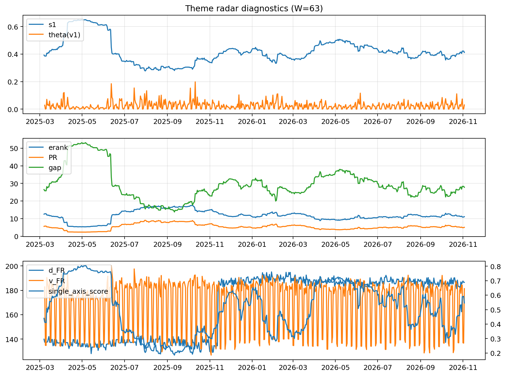

# Theme Radar Daily Brief — 2026-11-03

## Leaders (v1) — W=63
- **Nuclear_Uranium** (0.0806894013267323)
- Semis (0.072657164806375)
- Space (0.0590433836715837)

## Challengers — W=63
**v2:** Rates (0.1356043544738869), Semis (0.0796256034824331), Credit (0.0513657221005658)
**v3:** Software_Cloud (0.1028073623886461), Grid_Power (0.0796580891699437), Genomics_Bio (0.0710857384323723)

## Migration (20D slope) — W=63
**Top risers:**
- axis_Semis: 0.0006597254299327
- axis_MegaCap_AI: 0.0004172122070854
- axis_Crypto: 0.0003307305604301
- axis_Grid_Power: 0.0003014057551691
- axis_Sector_ConsStap: 0.0002482034331403
- axis_Space: 0.0001724697977637
- axis_Metals: 0.0001664711899861
- axis_Critical_Minerals: 0.0001602679936833
- axis_Miners: 0.0001427595708919
- axis_Sector_Health: 0.000137161482396

**Top fallers:**
- axis_Clean_Solar: -7.274084972751474e-05
- axis_Equity_US: -0.0001039332179641
- axis_Drones_Autonomy: -0.0001054911801282
- axis_Clean_Broad: -0.000162823708814
- axis_Sector_Utilities: -0.0001877480274491
- axis_Sector_Materials: -0.0002120109447612
- axis_USD: -0.0002946845723021
- axis_Sector_RealEstate: -0.0003258619716397
- axis_Credit: -0.000392175314342
- axis_Rates: -0.0015903470959768

## Risk line (W=63)
- s1: 0.4119957720663261
- theta_v1: 0.0305513765084296
- v_FR: 181.4099835418517
- single_axis_score: 0.5459637561779243

## Interpretation
**Regime:** `theme_migration`

- Action: Tomorrow watchlist: Semis, MegaCap_AI, Crypto, Grid_Power, Sector_ConsStap + v2_top1=Rates
- Action: Hedge note: normal correlation stability.

- Percentiles (W=63 history): vfr_pct=0.55, theta_pct=0.67, s1_pct=0.55, score_pct=0.56.

---
**BUNDLE_ROOT_SHA256:** `b9735caf6d02e510399e0c41f710009e28a5026c19f1afb7141cc5de00d84dd1`
