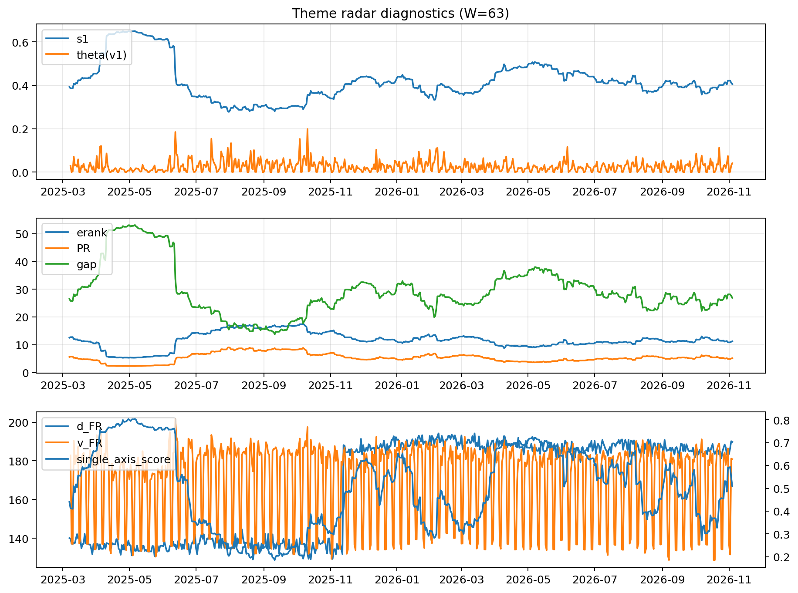

# Theme Radar Daily Brief — 2026-11-04

## Leaders (v1) — W=63
- **Nuclear_Uranium** (0.083854751459368)
- Semis (0.0748047128210526)
- Space (0.0602178679731698)

## Challengers — W=63
**v2:** Rates (0.1329715485926507), Semis (0.0713429783331667), Credit (0.0500634655805745)
**v3:** Software_Cloud (0.1018108401421888), Grid_Power (0.0786174814954072), Genomics_Bio (0.0725049898124123)

## Migration (20D slope) — W=63
**Top risers:**
- axis_Semis: 0.0007215806293167
- axis_MegaCap_AI: 0.0003939779496564
- axis_Grid_Power: 0.0003578947393974
- axis_Crypto: 0.0002954037315488
- axis_Sector_ConsStap: 0.0002509284031604
- axis_Space: 0.0002348747885542
- axis_Critical_Minerals: 0.0001605223312914
- axis_Metals: 0.0001436609772001
- axis_Nuclear_Uranium: 0.0001398845683139
- axis_Sector_Health: 0.000137488714942

**Top fallers:**
- axis_Equity_US: -7.482587432923101e-05
- axis_Clean_Solar: -9.224758700602852e-05
- axis_Drones_Autonomy: -9.479440344550544e-05
- axis_Clean_Broad: -0.0001617017453637
- axis_Sector_Utilities: -0.0001702705211125
- axis_Sector_Materials: -0.0002336576188656
- axis_USD: -0.000314891785245
- axis_Sector_RealEstate: -0.0003294642169993
- axis_Credit: -0.0004017033874679
- axis_Rates: -0.0016687129862865

## Risk line (W=63)
- s1: 0.4053292691709562
- theta_v1: 0.0410956840908091
- v_FR: 180.8524399967299
- single_axis_score: 0.5088815789473684

## Interpretation
**Regime:** `theme_migration`

- Action: Tomorrow watchlist: Semis, MegaCap_AI, Grid_Power, Crypto, Sector_ConsStap + v2_top1=Rates
- Action: Hedge note: normal correlation stability.

- Percentiles (W=63 history): vfr_pct=0.52, theta_pct=0.80, s1_pct=0.48, score_pct=0.48.

---
**BUNDLE_ROOT_SHA256:** `af81c7addc850d7579f6f421201f05f570b4d51762d11a148b506d20f8d5c8d8`
