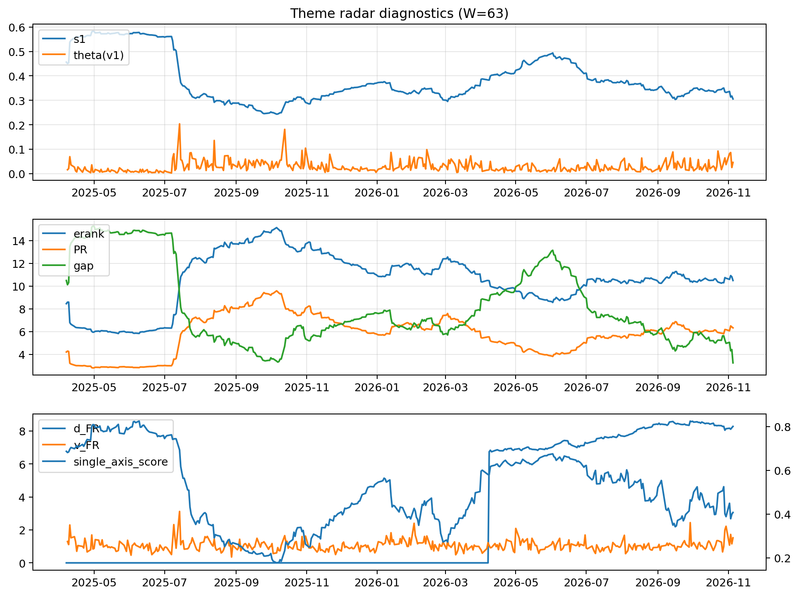

# Theme Radar Daily Brief — 2026-11-05

## Leaders (v1) — W=63
- **Genomics_Bio** (0.1156882170571039)
- Quantum (0.1079439326396937)
- Semis (0.0996557139423137)

## Challengers — W=63
**v2:** Rates (0.1078282259447756), Genomics_Bio (0.0746868402095765), Semis (0.0744674378713151)
**v3:** Genomics_Bio (0.1556456570490484), Grid_Power (0.1418599832801099), Defense (0.0936497550701227)

## Migration (20D slope) — W=63
**Top risers:**
- axis_Metals: 0.0007598624009273
- axis_Semis: 0.000705309115882
- axis_Sector_ConsDisc: 0.0005067711977215
- axis_Sector_ConsStap: 0.0004338125402092
- axis_MegaCap_AI: 0.0003608280741132
- axis_Sector_RealEstate: 0.0003541497518299
- axis_Genomics_Bio: 0.0002757678988476
- axis_Critical_Minerals: 0.0002497511537438
- axis_Sector_Ind: 0.0002091580643919
- axis_Quantum: 0.0001872010088081

**Top fallers:**
- axis_Software_Cloud: 0.0
- axis_Sector_Materials: -6.473291305250185e-05
- axis_Space: -8.012416849647623e-05
- axis_Sector_Health: -0.0001397137334427
- axis_Nuclear_Uranium: -0.0001720861609757
- axis_Commodities: -0.0002151019383097
- axis_Defense: -0.0004037522159574
- axis_Sector_Utilities: -0.0005164310955464
- axis_Sector_Fin: -0.0005367641888988
- axis_Rates: -0.0022859215010067

## Risk line (W=63)
- s1: 0.3057078133373806
- theta_v1: 0.0460430276706923
- v_FR: 1.518614956048146
- single_axis_score: 0.407017543859649

## Interpretation
**Regime:** `structure_rewrite`

- Action: Tomorrow watchlist: Metals, Semis, Sector_ConsDisc, Sector_ConsStap, MegaCap_AI + v2_top1=Rates
- Action: Hedge note: v_FR high + theta high → correlation structure unstable; diversify hedges / reduce reliance on static correlations.

- Percentiles (W=63 history): vfr_pct=0.93, theta_pct=0.82, s1_pct=0.17, score_pct=0.35.

---
**BUNDLE_ROOT_SHA256:** `49dd1752f0aa509ccc8c1d48b0f3f5985b7c3d608ea7569990ff0c8639ad3e90`
