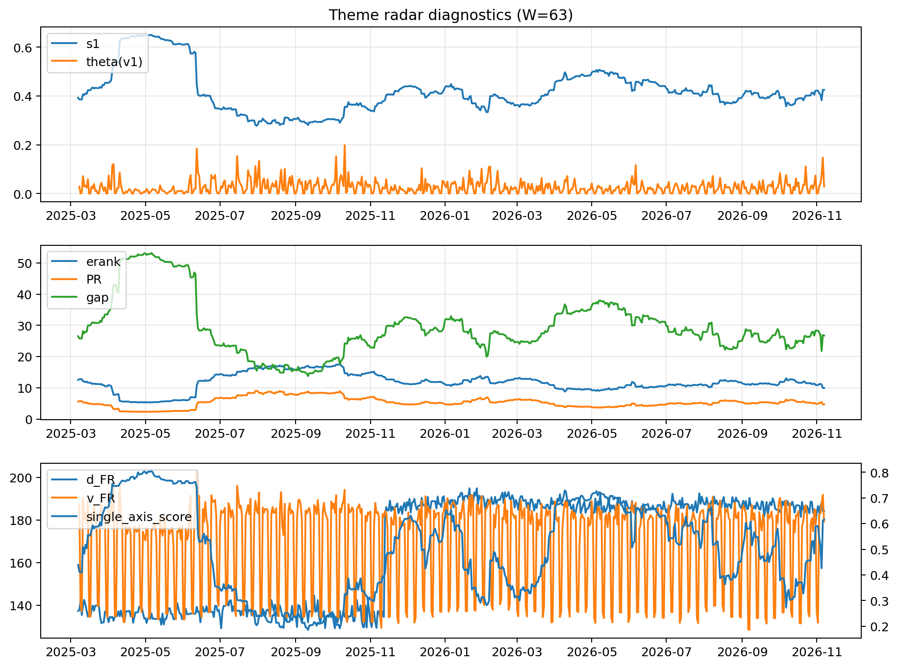

# Theme Radar Daily Brief — 2026-11-07

## Leaders (v1) — W=63
- **Nuclear_Uranium** (0.0804897110687736)
- Semis (0.0781787931654107)
- Genomics_Bio (0.0602873158768153)

## Challengers — W=63
**v2:** Rates (0.0819255506667261), Metals (0.0751550953329903), Semis (0.0581112963235019)
**v3:** Rates (0.082493419232002), MegaCap_AI (0.0774869046521548), Crypto (0.0767876360787917)

## Migration (20D slope) — W=63
**Top risers:**
- axis_Semis: 0.0007818752190151
- axis_Genomics_Bio: 0.0004644861371284
- axis_MegaCap_AI: 0.0003241398114878
- axis_Crypto: 0.0003140696690415
- axis_Space: 0.0002344580964001
- axis_Nuclear_Uranium: 0.0002199334288623
- axis_Software_Cloud: 0.0001892579668058
- axis_Quantum: 0.0001724635855421
- axis_Grid_Power: 0.0001668702611528
- axis_Cyber: 0.0001572786497292

**Top fallers:**
- axis_Clean_Solar: -0.000134878861555
- axis_Sector_Materials: -0.0001377608143622
- axis_Sector_Energy: -0.0001431499933056
- axis_Commodities: -0.0001646990718093
- axis_Clean_Broad: -0.0001706608731923
- axis_Sector_RealEstate: -0.0002234263023447
- axis_Metals: -0.0003142641483498
- axis_USD: -0.0003712498689206
- axis_Credit: -0.0004092302077081
- axis_Rates: -0.0015171368498257

## Risk line (W=63)
- s1: 0.4249386253785278
- theta_v1: 0.0291770277559513
- v_FR: 179.21259086136132
- single_axis_score: 0.6157119476268413

## Interpretation
**Regime:** `theme_migration`

- Action: Tomorrow watchlist: Semis, Genomics_Bio, MegaCap_AI, Crypto, Space + v2_top1=Rates
- Action: Hedge note: normal correlation stability.

- Percentiles (W=63 history): vfr_pct=0.43, theta_pct=0.64, s1_pct=0.65, score_pct=0.70.

---
**BUNDLE_ROOT_SHA256:** `319afceaea187bbee0558a84325fb9543dede5b1ec00a10cbfcf837bd62444dd`
