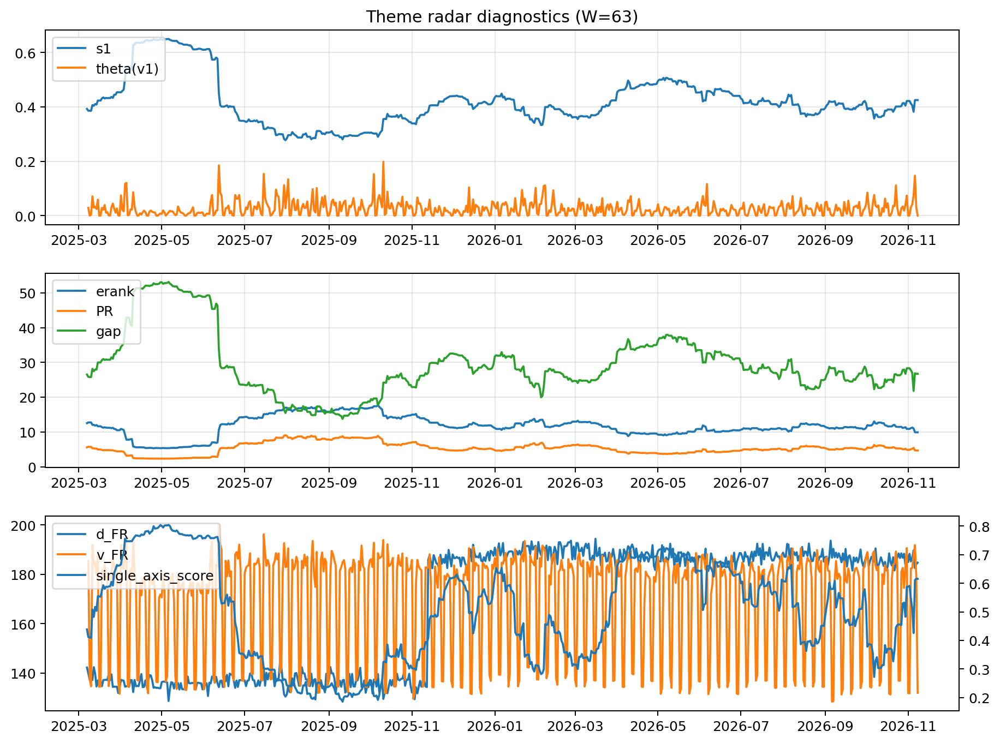

# Theme Radar Daily Brief — 2026-11-08

## Leaders (v1) — W=63
- **Nuclear_Uranium** (0.0804875568317405)
- Semis (0.0781787666926309)
- Genomics_Bio (0.0602880926772622)

## Challengers — W=63
**v2:** Rates (0.0819187505338906), Metals (0.0751496837101581), Semis (0.0581105701254477)
**v3:** Rates (0.0824985208685706), MegaCap_AI (0.0774846709603381), Crypto (0.0768550092501475)

## Migration (20D slope) — W=63
**Top risers:**
- axis_Semis: 0.0007984198388426
- axis_Genomics_Bio: 0.000582136843799
- axis_Crypto: 0.0003029162201561
- axis_MegaCap_AI: 0.0002915887818981
- axis_Space: 0.0002364868411586
- axis_Nuclear_Uranium: 0.0002347848696271
- axis_Software_Cloud: 0.0002299275801335
- axis_Cyber: 0.000192048346005
- axis_Quantum: 0.0001800169700646
- axis_Grid_Power: 0.0001322335220509

**Top fallers:**
- axis_Sector_Utilities: -0.0001121042617696
- axis_Clean_Solar: -0.0001439682481534
- axis_Clean_Broad: -0.0001692252459728
- axis_Sector_Energy: -0.0001751874696673
- axis_Sector_RealEstate: -0.0001813076044978
- axis_Commodities: -0.0002157678222893
- axis_USD: -0.0003979300605536
- axis_Credit: -0.0004072231602827
- axis_Metals: -0.0005240188205386
- axis_Rates: -0.0014060957031972

## Risk line (W=63)
- s1: 0.4249379997513079
- theta_v1: 3.452005395168173e-05
- v_FR: 131.9795643708013
- single_axis_score: 0.615359477124183

## Interpretation
**Regime:** `theme_migration`

- Action: Tomorrow watchlist: Semis, Genomics_Bio, Crypto, MegaCap_AI, Space + v2_top1=Rates
- Action: Hedge note: normal correlation stability.

- Percentiles (W=63 history): vfr_pct=0.04, theta_pct=0.02, s1_pct=0.65, score_pct=0.70.

---
**BUNDLE_ROOT_SHA256:** `f142d508279f5d53a6d911bfa4da32abfab50a66df569a60fed67baf25ce03f2`
