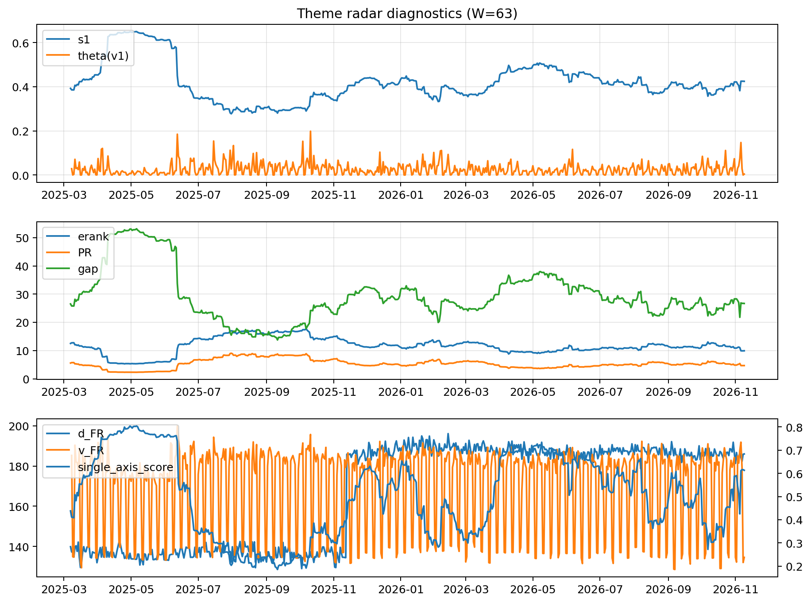

# Theme Radar Daily Brief — 2026-11-09

## Leaders (v1) — W=63
- **Nuclear_Uranium** (0.0805493203680264)
- Semis (0.0782348999580598)
- Genomics_Bio (0.0603243527856165)

## Challengers — W=63
**v2:** Rates (0.0819924412555759), Metals (0.0751668695420494), Semis (0.0580807527142401)
**v3:** Rates (0.0822123550805373), MegaCap_AI (0.0775571119396469), Crypto (0.0766747747101796)

## Migration (20D slope) — W=63
**Top risers:**
- axis_Semis: 0.000794175198162
- axis_Genomics_Bio: 0.000682833326447
- axis_Crypto: 0.000270477796234
- axis_Software_Cloud: 0.0002704381619769
- axis_MegaCap_AI: 0.0002526843661267
- axis_Nuclear_Uranium: 0.0002460771731219
- axis_Space: 0.0002351237941106
- axis_Cyber: 0.0002239879067558
- axis_Quantum: 0.0001845295001292
- axis_Equity_US: 0.0001316531353699

**Top fallers:**
- axis_Sector_RealEstate: -0.0001373181759046
- axis_Clean_Solar: -0.0001492320800528
- axis_Clean_Broad: -0.0001638141125582
- axis_Miners: -0.0001676136065483
- axis_Sector_Energy: -0.0001973679894455
- axis_Commodities: -0.0002568616304081
- axis_Credit: -0.0003940368900271
- axis_USD: -0.0004154545570639
- axis_Metals: -0.0007077976390868
- axis_Rates: -0.001267365045773

## Risk line (W=63)
- s1: 0.4245411881053065
- theta_v1: 0.0042102376594258
- v_FR: 134.52960117246906
- single_axis_score: 0.6130505709624796

## Interpretation
**Regime:** `theme_migration`

- Action: Tomorrow watchlist: Semis, Genomics_Bio, Crypto, Software_Cloud, MegaCap_AI + v2_top1=Rates
- Action: Hedge note: normal correlation stability.

- Percentiles (W=63 history): vfr_pct=0.11, theta_pct=0.28, s1_pct=0.64, score_pct=0.69.

---
**BUNDLE_ROOT_SHA256:** `692175828a72d788b716f7d9d16fa46bd3d587e2f6f8d12900784f11f40f91bc`
