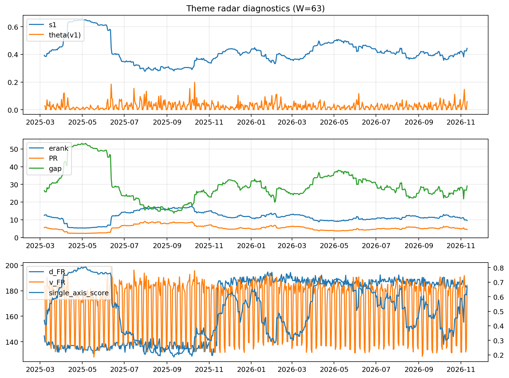

# Theme Radar Daily Brief — 2026-11-10

## Leaders (v1) — W=63
- **Nuclear_Uranium** (0.0808028568625651)
- Semis (0.0761811581756902)
- Genomics_Bio (0.0586532511978526)

## Challengers — W=63
**v2:** Rates (0.0880929965051308), Metals (0.0749144085127709), Semis (0.0606793988035925)
**v3:** Crypto (0.0863457379368879), MegaCap_AI (0.0800446522398875), Rates (0.0786856548670752)

## Migration (20D slope) — W=63
**Top risers:**
- axis_Genomics_Bio: 0.0007520408344044
- axis_Semis: 0.0007007415832589
- axis_Software_Cloud: 0.0003253889893274
- axis_Cyber: 0.0002672397781834
- axis_Nuclear_Uranium: 0.0002455844155057
- axis_Space: 0.0002036514796119
- axis_Crypto: 0.0001824103078136
- axis_MegaCap_AI: 0.0001773475714747
- axis_Quantum: 0.0001617697928071
- axis_Sector_Fin: 0.0001524109937519

**Top fallers:**
- axis_Sector_ConsStap: -0.0001287106049425
- axis_Clean_Broad: -0.0001706453429142
- axis_Clean_Solar: -0.0001712176470514
- axis_Miners: -0.0002228155448071
- axis_Sector_Energy: -0.0002251651808256
- axis_Commodities: -0.0002534006825882
- axis_Credit: -0.0003410521552383
- axis_USD: -0.0003907259625335
- axis_Metals: -0.0008645665446598
- axis_Rates: -0.0010282355541101

## Risk line (W=63)
- s1: 0.4437968848875226
- theta_v1: 0.0591981084587557
- v_FR: 183.7972400252035
- single_axis_score: 0.665798045602606

## Interpretation
**Regime:** `theme_migration`

- Action: Tomorrow watchlist: Genomics_Bio, Semis, Software_Cloud, Cyber, Nuclear_Uranium + v2_top1=Rates
- Action: Hedge note: normal correlation stability.

- Percentiles (W=63 history): vfr_pct=0.72, theta_pct=0.91, s1_pct=0.74, score_pct=0.78.

---
**BUNDLE_ROOT_SHA256:** `c7bbad3329d6b40019fdd9254537876307fb8433f4546de10d683248ed1a878d`
