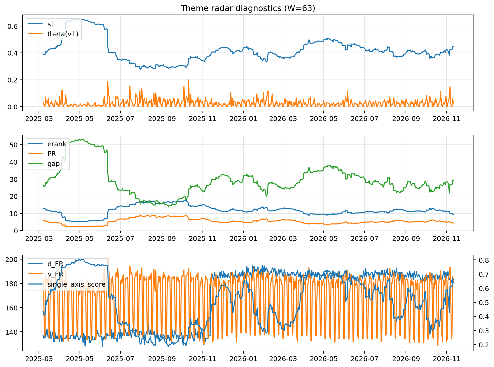

# Theme Radar Daily Brief — 2026-11-11

## Leaders (v1) — W=63
- **Nuclear_Uranium** (0.0814521557782665)
- Semis (0.0745363158529213)
- Genomics_Bio (0.0595153658248819)

## Challengers — W=63
**v2:** Rates (0.0932413825571522), Metals (0.0747018151778175), Semis (0.0645473149213662)
**v3:** Crypto (0.0844696072889662), MegaCap_AI (0.0798405299693385), Rates (0.0735774427143044)

## Migration (20D slope) — W=63
**Top risers:**
- axis_Genomics_Bio: 0.0008253761414472
- axis_Semis: 0.0006042135984522
- axis_Software_Cloud: 0.0003862735247609
- axis_Cyber: 0.0003204550168594
- axis_Nuclear_Uranium: 0.0002337835845297
- axis_Sector_Fin: 0.0002071835573338
- axis_Drones_Autonomy: 0.0001683550839138
- axis_Equity_US: 0.0001646744348126
- axis_Space: 0.0001491010542859
- axis_Quantum: 0.0001460205927947

**Top fallers:**
- axis_Clean_Broad: -0.0001726600511579
- axis_Clean_Solar: -0.0001895511653396
- axis_Sector_ConsStap: -0.0002107490973584
- axis_Commodities: -0.0002406733111583
- axis_Sector_Energy: -0.000245512813107
- axis_Miners: -0.0002705559633586
- axis_Credit: -0.0002725216698627
- axis_USD: -0.0003552786597715
- axis_Rates: -0.0008002233752735
- axis_Metals: -0.0009987804186823

## Risk line (W=63)
- s1: 0.4461968172122698
- theta_v1: 0.0259210018627646
- v_FR: 182.52719242370316
- single_axis_score: 0.6595121951219511

## Interpretation
**Regime:** `theme_migration`

- Action: Tomorrow watchlist: Genomics_Bio, Semis, Software_Cloud, Cyber, Nuclear_Uranium + v2_top1=Rates
- Action: Hedge note: normal correlation stability.

- Percentiles (W=63 history): vfr_pct=0.61, theta_pct=0.58, s1_pct=0.74, score_pct=0.77.

---
**BUNDLE_ROOT_SHA256:** `6cfb42bed373e47a3f8ea90be5027e74e281d0e6808869167a71d216b73e3b78`
