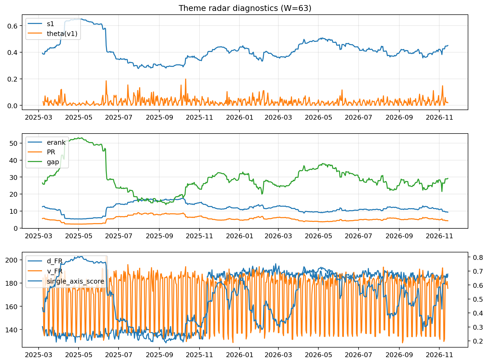

# Theme Radar Daily Brief — 2026-11-14

## Leaders (v1) — W=63
- **Nuclear_Uranium** (0.0844655981731224)
- Semis (0.0727092195321408)
- Genomics_Bio (0.0599639298553287)

## Challengers — W=63
**v2:** Rates (0.0989965681918171), Metals (0.0748271469724992), Semis (0.0679913077740733)
**v3:** Crypto (0.0818444093723985), MegaCap_AI (0.0813771434256522), Rates (0.0758613101081553)

## Migration (20D slope) — W=63
**Top risers:**
- axis_Genomics_Bio: 0.0008807662715587
- axis_Software_Cloud: 0.0004491427719015
- axis_Semis: 0.0004282910402631
- axis_Cyber: 0.0003865693268323
- axis_Drones_Autonomy: 0.0003033557042123
- axis_Sector_Fin: 0.0002380007309047
- axis_Defense: 0.0002305617548923
- axis_Nuclear_Uranium: 0.0002206428491269
- axis_Sector_Comm: 0.0001740392443354
- axis_Equity_US: 0.0001504554912629

**Top fallers:**
- axis_Critical_Minerals: -0.0001491332883562
- axis_Clean_Solar: -0.0001970050936789
- axis_Credit: -0.0002583042175878
- axis_Commodities: -0.0002624693413448
- axis_USD: -0.0002714204231948
- axis_Sector_ConsStap: -0.0002853801446169
- axis_Miners: -0.0002989566437275
- axis_Sector_Energy: -0.0003271464403061
- axis_Rates: -0.0005957225202636
- axis_Metals: -0.0011102199500035

## Risk line (W=63)
- s1: 0.4504906307612462
- theta_v1: 0.0198985968956507
- v_FR: 175.4179817797847
- single_axis_score: 0.6653721682847896

## Interpretation
**Regime:** `theme_migration`

- Action: Tomorrow watchlist: Genomics_Bio, Software_Cloud, Semis, Cyber, Drones_Autonomy + v2_top1=Rates
- Action: Hedge note: normal correlation stability.

- Percentiles (W=63 history): vfr_pct=0.33, theta_pct=0.49, s1_pct=0.75, score_pct=0.78.

---
**BUNDLE_ROOT_SHA256:** `8f55fa9a48c057ae01a03b916b78a7b930d9268e31434f53eea6c27eb2ad2aba`
