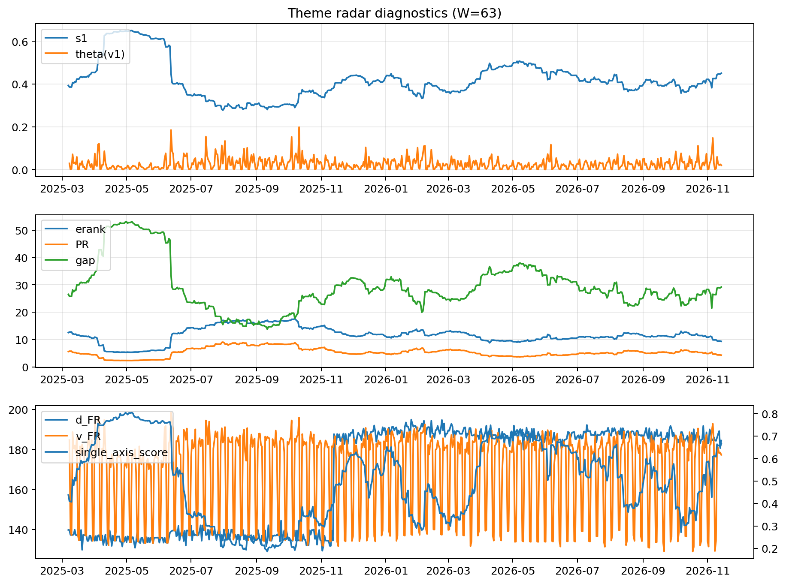

# Theme Radar Daily Brief — 2026-11-14

## Leaders (v1) — W=63
- **Nuclear_Uranium** (0.0844655979730341)
- Semis (0.0727092195086922)
- Genomics_Bio (0.0599639296946679)

## Challengers — W=63
**v2:** Rates (0.098996565634803), Metals (0.0748271441909189), Semis (0.0679913238038305)
**v3:** Crypto (0.0818443828330868), MegaCap_AI (0.0813771359491592), Rates (0.075861317784091)

## Migration (20D slope) — W=63
**Top risers:**
- axis_Genomics_Bio: 0.0008807662649422
- axis_Software_Cloud: 0.0004491427361582
- axis_Semis: 0.0004282909194903
- axis_Cyber: 0.0003865692705484
- axis_Drones_Autonomy: 0.0003033556372903
- axis_Sector_Fin: 0.0002380007046763
- axis_Defense: 0.0002305616674329
- axis_Nuclear_Uranium: 0.00022064275234
- axis_Sector_Comm: 0.0001740392222194
- axis_Equity_US: 0.0001504554062611

**Top fallers:**
- axis_Critical_Minerals: -0.0001491333165704
- axis_Clean_Solar: -0.0001970050970505
- axis_Credit: -0.0002583055696639
- axis_Commodities: -0.0002624693354364
- axis_USD: -0.0002714204102034
- axis_Sector_ConsStap: -0.0002853801892347
- axis_Miners: -0.0002989566346169
- axis_Sector_Energy: -0.0003271464004677
- axis_Rates: -0.0005957195437725
- axis_Metals: -0.0011102199619899

## Risk line (W=63)
- s1: 0.4504906307769211
- theta_v1: 0.0198985972117168
- v_FR: 177.3027225908253
- single_axis_score: 0.6653721682847896

## Interpretation
**Regime:** `theme_migration`

- Action: Tomorrow watchlist: Genomics_Bio, Software_Cloud, Semis, Cyber, Drones_Autonomy + v2_top1=Rates
- Action: Hedge note: normal correlation stability.

- Percentiles (W=63 history): vfr_pct=0.36, theta_pct=0.49, s1_pct=0.75, score_pct=0.78.

---
**BUNDLE_ROOT_SHA256:** `9f8fccecde65bc8ab2fa3dbe0b3e1423f123eaa91a3fab6bab6979743f77c045`
