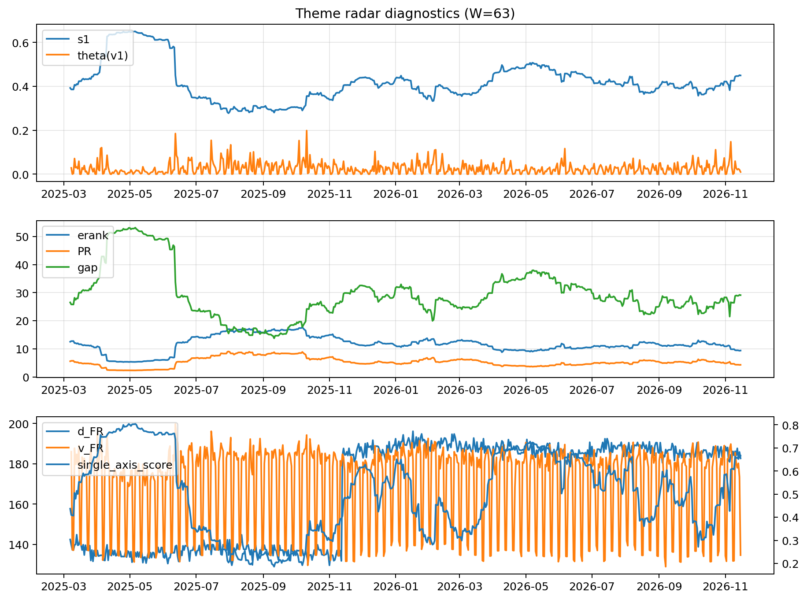

# Theme Radar Daily Brief — 2026-11-15

## Leaders (v1) — W=63
- **Nuclear_Uranium** (0.084637172858926)
- Semis (0.0728503569297131)
- Genomics_Bio (0.0600322096289818)

## Challengers — W=63
**v2:** Rates (0.0991858911326457), Metals (0.0748965910857451), Semis (0.0679594084517607)
**v3:** MegaCap_AI (0.0818371983160368), Crypto (0.0799462087635687), Rates (0.0762335831856171)

## Migration (20D slope) — W=63
**Top risers:**
- axis_Genomics_Bio: 0.0008622529587035
- axis_Software_Cloud: 0.000447664970218
- axis_Cyber: 0.0003914606430779
- axis_Semis: 0.0003505493237603
- axis_Drones_Autonomy: 0.0003392771404311
- axis_Defense: 0.0002740550170697
- axis_Nuclear_Uranium: 0.0002394525454176
- axis_Sector_Fin: 0.0002301235077934
- axis_Sector_Comm: 0.0001732895449158
- axis_Sector_Materials: 0.0001525318491477

**Top fallers:**
- axis_Critical_Minerals: -0.0001570075251793
- axis_Clean_Solar: -0.0001862917308888
- axis_USD: -0.000227152099218
- axis_Credit: -0.0002513818311494
- axis_Commodities: -0.0002692579205616
- axis_Sector_ConsStap: -0.0002949752441196
- axis_Miners: -0.0002996491353091
- axis_Sector_Energy: -0.0003414408664453
- axis_Rates: -0.000500803712781
- axis_Metals: -0.0011158350849362

## Risk line (W=63)
- s1: 0.44941909805133
- theta_v1: 0.0097443881414492
- v_FR: 134.68121670156972
- single_axis_score: 0.6662358642972536

## Interpretation
**Regime:** `theme_migration`

- Action: Tomorrow watchlist: Genomics_Bio, Software_Cloud, Cyber, Semis, Drones_Autonomy + v2_top1=Rates
- Action: Hedge note: normal correlation stability.

- Percentiles (W=63 history): vfr_pct=0.12, theta_pct=0.32, s1_pct=0.75, score_pct=0.78.

---
**BUNDLE_ROOT_SHA256:** `3858cfdb9e0793fec15b44a3c15533145738d693c46c8a60c60c76d912211be9`
