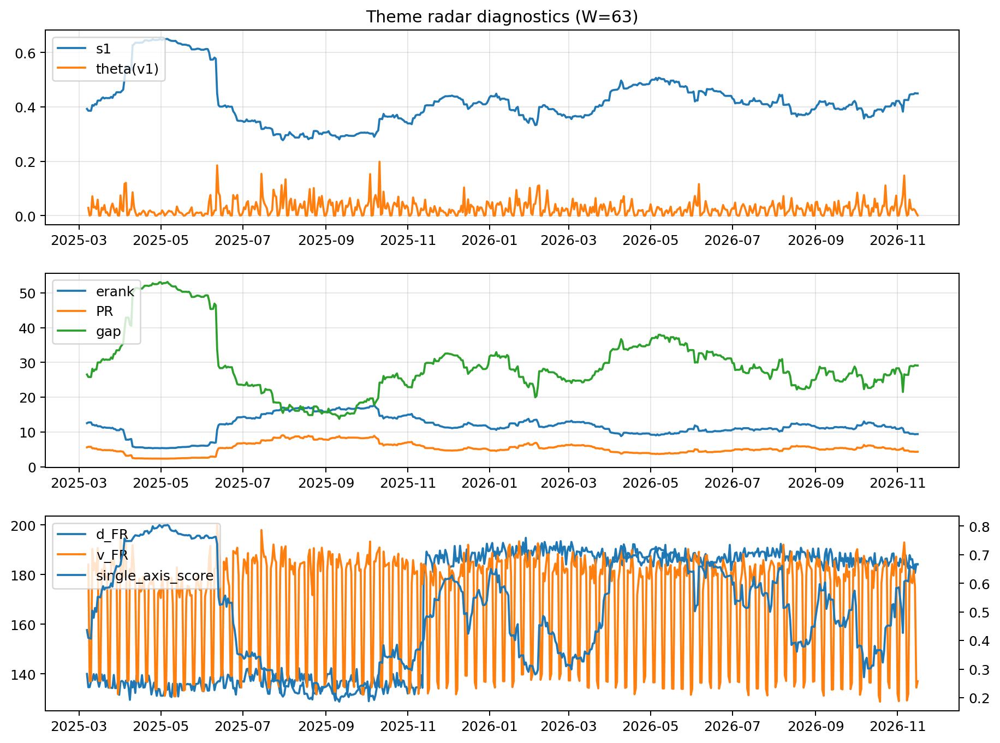

# Theme Radar Daily Brief — 2026-11-16

## Leaders (v1) — W=63
- **Nuclear_Uranium** (0.0846609562730994)
- Semis (0.0728606609942714)
- Genomics_Bio (0.0600351053870628)

## Challengers — W=63
**v2:** Rates (0.0992291897089218), Metals (0.0749344984166271), Semis (0.0679664411971099)
**v3:** MegaCap_AI (0.0818250859088636), Crypto (0.0795046115018373), Rates (0.0761901589716158)

## Migration (20D slope) — W=63
**Top risers:**
- axis_Genomics_Bio: 0.0008060742077059
- axis_Software_Cloud: 0.0004333743814465
- axis_Cyber: 0.0003864467015739
- axis_Drones_Autonomy: 0.0003621812130722
- axis_Defense: 0.0003086374333753
- axis_Semis: 0.0002553561064155
- axis_Nuclear_Uranium: 0.0002430550882775
- axis_Sector_Fin: 0.0002300339379297
- axis_Sector_Comm: 0.0001661995705224
- axis_Sector_Materials: 0.0001641389653078

**Top fallers:**
- axis_Critical_Minerals: -0.0001545386636213
- axis_Clean_Solar: -0.0001761811750716
- axis_USD: -0.0001809445368533
- axis_Credit: -0.0002247153157402
- axis_Commodities: -0.0002477768090314
- axis_Miners: -0.0002870706172561
- axis_Sector_ConsStap: -0.0003041437436625
- axis_Sector_Energy: -0.0003460745845628
- axis_Rates: -0.0003666818015889
- axis_Metals: -0.0010946383939698

## Risk line (W=63)
- s1: 0.4493402995650366
- theta_v1: 0.0008315760117538
- v_FR: 137.0771009858952
- single_axis_score: 0.6658064516129032

## Interpretation
**Regime:** `theme_migration`

- Action: Tomorrow watchlist: Genomics_Bio, Software_Cloud, Cyber, Drones_Autonomy, Defense + v2_top1=Rates
- Action: Hedge note: normal correlation stability.

- Percentiles (W=63 history): vfr_pct=0.20, theta_pct=0.21, s1_pct=0.75, score_pct=0.78.

---
**BUNDLE_ROOT_SHA256:** `2f8cb50af8e2bd2c93eed8e551d450c7038d39706828428c1d9be446ac228220`
