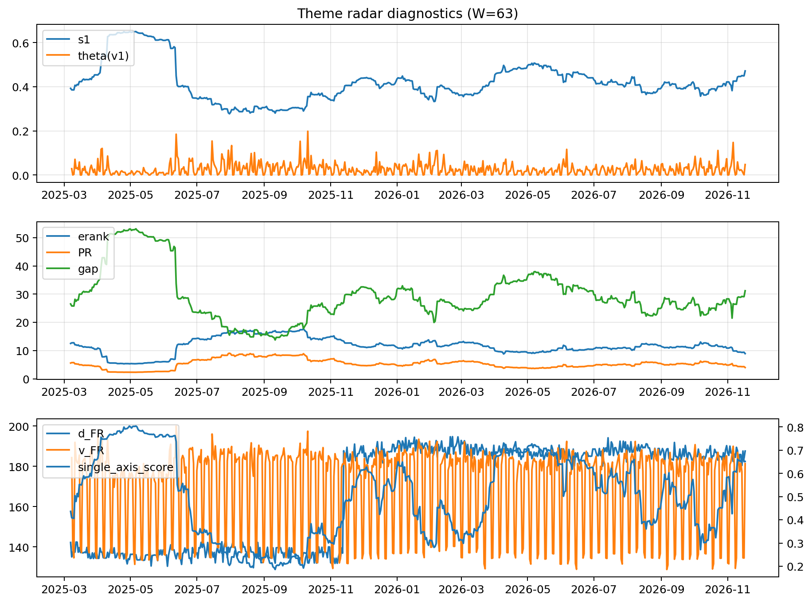

# Theme Radar Daily Brief — 2026-11-17

## Leaders (v1) — W=63
- **Nuclear_Uranium** (0.0833542803853037)
- Semis (0.0723185420905432)
- Genomics_Bio (0.0600052381104242)

## Challengers — W=63
**v2:** Rates (0.1008566314099929), Metals (0.0743871447217634), Semis (0.0674854630540187)
**v3:** Rates (0.0955058101220313), MegaCap_AI (0.0831232512490576), Nuclear_Uranium (0.0678648976266392)

## Migration (20D slope) — W=63
**Top risers:**
- axis_Genomics_Bio: 0.0007570776445492
- axis_Software_Cloud: 0.0004569241233075
- axis_Cyber: 0.0004348328583937
- axis_Drones_Autonomy: 0.0004055748786268
- axis_Defense: 0.0003275478217514
- axis_Nuclear_Uranium: 0.0002328267156321
- axis_Sector_Fin: 0.0002182742746444
- axis_Sector_Materials: 0.0001807265186735
- axis_Sector_Comm: 0.0001616306382547
- axis_Semis: 0.0001601162239904

**Top fallers:**
- axis_USD: -0.0001507308753026
- axis_Grid_Power: -0.000159318236329
- axis_Clean_Solar: -0.0001619771133584
- axis_Credit: -0.0002003865525552
- axis_Rates: -0.0002493927326815
- axis_Commodities: -0.0002718938349186
- axis_Miners: -0.0002750899732652
- axis_Sector_ConsStap: -0.0003104672429246
- axis_Sector_Energy: -0.0003494999608593
- axis_Metals: -0.0010631963681581

## Risk line (W=63)
- s1: 0.47159830344749
- theta_v1: 0.047460143892604
- v_FR: 181.3680116341638
- single_axis_score: 0.6959742351046699

## Interpretation
**Regime:** `theme_migration`

- Action: Tomorrow watchlist: Genomics_Bio, Software_Cloud, Cyber, Drones_Autonomy, Defense + v2_top1=Rates
- Action: Hedge note: normal correlation stability.

- Percentiles (W=63 history): vfr_pct=0.53, theta_pct=0.85, s1_pct=0.81, score_pct=0.84.

---
**BUNDLE_ROOT_SHA256:** `30c45a124c0952942e27e969c92c997e11b2b93797d2b419daaffdf2a98bcdc0`
