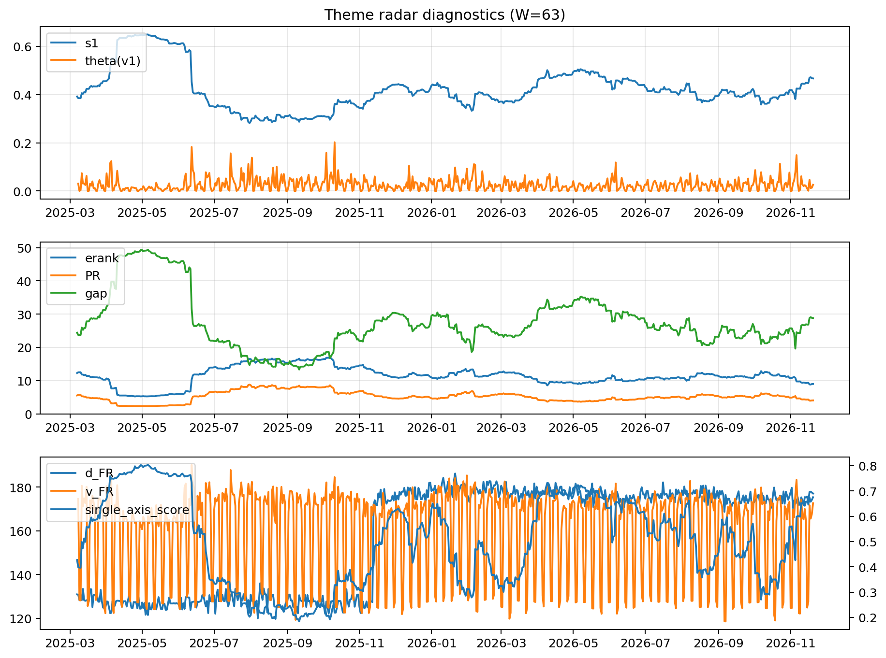

# Theme Radar Daily Brief — 2026-11-20

## Leaders (v1) — W=63
- **Nuclear_Uranium** (0.0884854132439852)
- Semis (0.0769623918420104)
- Genomics_Bio (0.0634044855467607)

## Challengers — W=63
**v2:** Rates (0.1068244133573036), Semis (0.0738572214474168), Metals (0.0602085632858278)
**v3:** Rates (0.1073345978104088), Nuclear_Uranium (0.0978474446941665), Drones_Autonomy (0.0695391040281918)

## Migration (20D slope) — W=63
**Top risers:**
- axis_Genomics_Bio: 0.0005256390965133
- axis_Drones_Autonomy: 0.0004682247104087
- axis_Cyber: 0.0004459751912746
- axis_Software_Cloud: 0.000439654966831
- axis_Defense: 0.0003549883449717
- axis_Sector_Materials: 0.0002439606639164
- axis_Sector_Fin: 0.0002090239901207
- axis_Sector_Health: 0.0002071006624016
- axis_Nuclear_Uranium: 0.0001816795608267
- axis_Sector_Comm: 0.0001620738868372

**Top fallers:**
- axis_Clean_Solar: -0.0001352751880416
- axis_Credit: -0.0001409737883742
- axis_Grid_Power: -0.0001498877267929
- axis_Quantum: -0.0001798200825021
- axis_Space: -0.0001815426949549
- axis_Miners: -0.0002225177727172
- axis_Commodities: -0.000302580912679
- axis_Sector_ConsStap: -0.0003297559218624
- axis_Sector_Energy: -0.0003453381956859
- axis_Metals: -0.0006987482667428

## Risk line (W=63)
- s1: 0.4671557880407014
- theta_v1: 0.0257764886983648
- v_FR: 172.6152569135769
- single_axis_score: 0.6900641025641026

## Interpretation
**Regime:** `theme_migration`

- Action: Tomorrow watchlist: Genomics_Bio, Drones_Autonomy, Cyber, Software_Cloud, Defense + v2_top1=Rates
- Action: Hedge note: normal correlation stability.

- Percentiles (W=63 history): vfr_pct=0.61, theta_pct=0.59, s1_pct=0.79, score_pct=0.83.

---
**BUNDLE_ROOT_SHA256:** `370813c00eb1353231bf464e6e5a3469ad0d762cdbe39d2ce78d74325fb80b2a`
