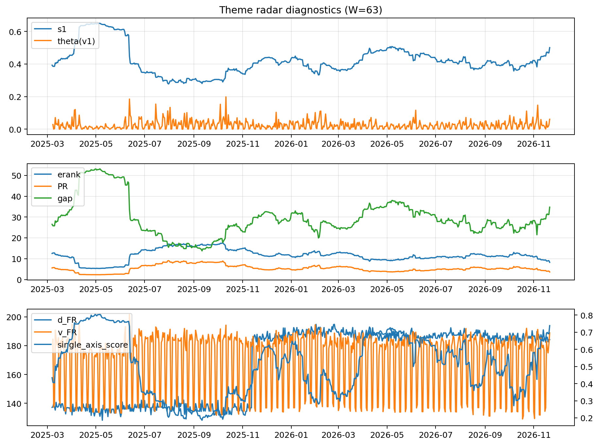

# Theme Radar Daily Brief — 2026-11-21

## Leaders (v1) — W=63
- **Nuclear_Uranium** (0.080679609545076)
- Semis (0.071469524869457)
- Space (0.0564600251500045)

## Challengers — W=63
**v2:** Rates (0.0977927555587298), Metals (0.0771490991196999), Semis (0.0632916047791654)
**v3:** Rates (0.1062551926740799), MegaCap_AI (0.0896100653701791), Nuclear_Uranium (0.0787203537736918)

## Migration (20D slope) — W=63
**Top risers:**
- axis_Drones_Autonomy: 0.0004673616320219
- axis_Software_Cloud: 0.0004383479887389
- axis_Cyber: 0.0004151680150293
- axis_Defense: 0.0003343911588802
- axis_Genomics_Bio: 0.0003006368308703
- axis_Sector_Materials: 0.0002290881535291
- axis_Rates: 0.0002060967331115
- axis_Sector_Fin: 0.0001983017794502
- axis_Sector_Comm: 0.0001808862582622
- axis_Sector_Health: 0.0001722494163243

**Top fallers:**
- axis_DataCenter_Infra: -0.0001371161463559
- axis_Space: -0.0001499998555072
- axis_Credit: -0.0001594714313441
- axis_Semis: -0.000175417937388
- axis_Miners: -0.0001900766313997
- axis_Quantum: -0.0001944364231124
- axis_Sector_Energy: -0.0002844311250567
- axis_Sector_ConsStap: -0.0002861558134304
- axis_Commodities: -0.0002892813755846
- axis_Metals: -0.0006562826097776

## Risk line (W=63)
- s1: 0.5006739553846472
- theta_v1: 0.0607606736399464
- v_FR: 188.8781234318844
- single_axis_score: 0.73824

## Interpretation
**Regime:** `structure_rewrite`

- Action: Tomorrow watchlist: Drones_Autonomy, Software_Cloud, Cyber, Defense, Genomics_Bio + v2_top1=Rates
- Action: Hedge note: v_FR high + theta high → correlation structure unstable; diversify hedges / reduce reliance on static correlations.

- Percentiles (W=63 history): vfr_pct=0.93, theta_pct=0.91, s1_pct=0.88, score_pct=0.89.

---
**BUNDLE_ROOT_SHA256:** `a3406e9f3894e848dbdcabb0d35519c40a0babacf691f2fd06126339291933b6`
