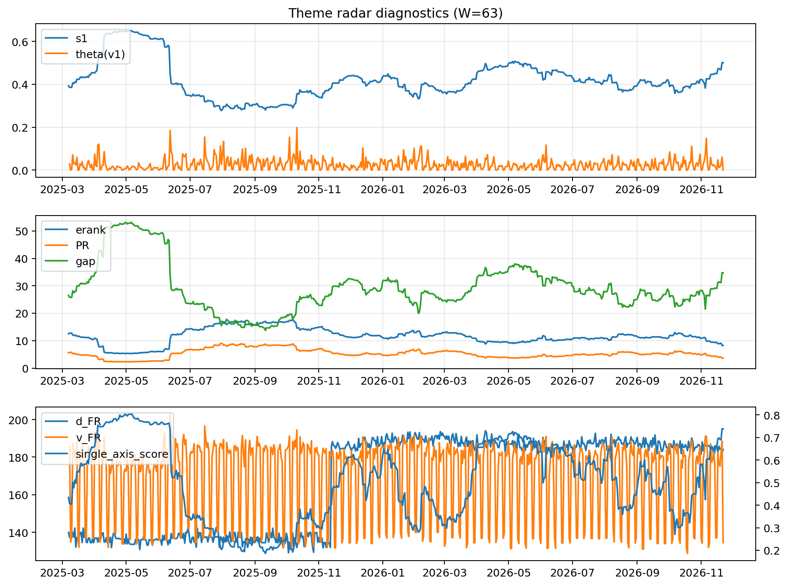

# Theme Radar Daily Brief — 2026-11-22

## Leaders (v1) — W=63
- **Nuclear_Uranium** (0.0807023748790783)
- Semis (0.0714850005838376)
- Space (0.0564738342567107)

## Challengers — W=63
**v2:** Rates (0.0978236334359294), Metals (0.077191668830761), Semis (0.0632942415583711)
**v3:** Rates (0.1063178769429257), MegaCap_AI (0.0896226256423804), Nuclear_Uranium (0.0785785108664629)

## Migration (20D slope) — W=63
**Top risers:**
- axis_Drones_Autonomy: 0.0004705809905119
- axis_Software_Cloud: 0.0004217246076416
- axis_Cyber: 0.0003841152721377
- axis_Rates: 0.0003359099003439
- axis_Defense: 0.0003268619676279
- axis_Sector_Materials: 0.0002319786185136
- axis_Sector_Comm: 0.0001980298076357
- axis_Sector_Fin: 0.0001967157790982
- axis_Sector_Health: 0.0001699207279586
- axis_Sector_RealEstate: 9.731542395340369e-05

**Top fallers:**
- axis_DataCenter_Infra: -0.0001475447640614
- axis_Miners: -0.0001538178753901
- axis_Space: -0.0001641250169754
- axis_Credit: -0.0001757246844827
- axis_Quantum: -0.0002379795524831
- axis_Sector_Energy: -0.0002437253236296
- axis_Semis: -0.0002493040055603
- axis_Sector_ConsStap: -0.0002597481940769
- axis_Commodities: -0.0002818988430406
- axis_Metals: -0.0004614228468592

## Risk line (W=63)
- s1: 0.5005234589846927
- theta_v1: 0.0012405427220748
- v_FR: 134.44421093523286
- single_axis_score: 0.7373801916932907

## Interpretation
**Regime:** `theme_migration`

- Action: Tomorrow watchlist: Drones_Autonomy, Software_Cloud, Cyber, Rates, Defense + v2_top1=Rates
- Action: Hedge note: normal correlation stability.

- Percentiles (W=63 history): vfr_pct=0.09, theta_pct=0.23, s1_pct=0.88, score_pct=0.89.

---
**BUNDLE_ROOT_SHA256:** `dd7e29d1d155c0dd48fd9b241aa05c7d097d0637febc8b0fae0d79f33b4a78b3`
