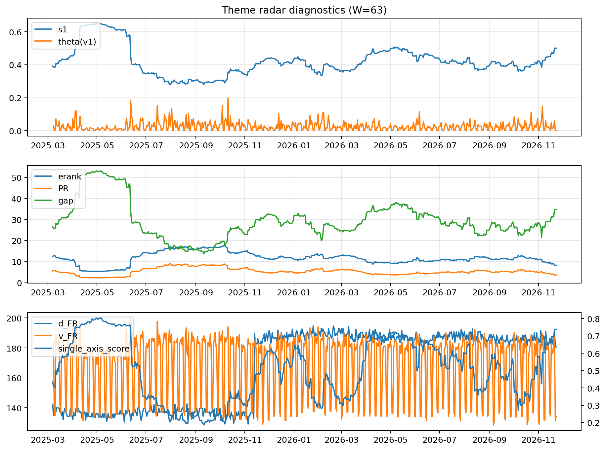

# Theme Radar Daily Brief — 2026-11-23

## Leaders (v1) — W=63
- **Nuclear_Uranium** (0.0807124328503663)
- Semis (0.0714904490117677)
- Space (0.0564786922298279)

## Challengers — W=63
**v2:** Rates (0.0978386413624823), Metals (0.0772178383572859), Semis (0.0632978932634348)
**v3:** Rates (0.1063384922330319), MegaCap_AI (0.0896153217870572), Nuclear_Uranium (0.078463624765454)

## Migration (20D slope) — W=63
**Top risers:**
- axis_Drones_Autonomy: 0.0004686032759342
- axis_Rates: 0.0004446395292214
- axis_Software_Cloud: 0.0003980096748447
- axis_Cyber: 0.0003465260028266
- axis_Defense: 0.0003006781134451
- axis_Sector_Materials: 0.0002208032223473
- axis_Sector_Comm: 0.0002088751025505
- axis_Sector_Fin: 0.0001808909850867
- axis_Sector_Health: 0.0001655875007603
- axis_MegaCap_AI: 8.443957718235377e-05

**Top fallers:**
- axis_Equity_US: -0.0001463228880753
- axis_DataCenter_Infra: -0.000146920612755
- axis_Space: -0.0001636846822677
- axis_Credit: -0.0001797593978225
- axis_Sector_Energy: -0.0002091618151556
- axis_Sector_ConsStap: -0.0002204894749299
- axis_Metals: -0.0002426171977994
- axis_Quantum: -0.0002671106922488
- axis_Commodities: -0.0003007857780838
- axis_Semis: -0.0003064453488698

## Risk line (W=63)
- s1: 0.5004678940980666
- theta_v1: 0.0004377875911883
- v_FR: 134.2620181320643
- single_axis_score: 0.7365231259968101

## Interpretation
**Regime:** `theme_migration`

- Action: Tomorrow watchlist: Drones_Autonomy, Rates, Software_Cloud, Cyber, Defense + v2_top1=Rates
- Action: Hedge note: normal correlation stability.

- Percentiles (W=63 history): vfr_pct=0.09, theta_pct=0.16, s1_pct=0.88, score_pct=0.89.

---
**BUNDLE_ROOT_SHA256:** `4b515d02adfd5ec1fcf8f866676820c81c662b7fbfcebb57cd528c57e20691e1`
