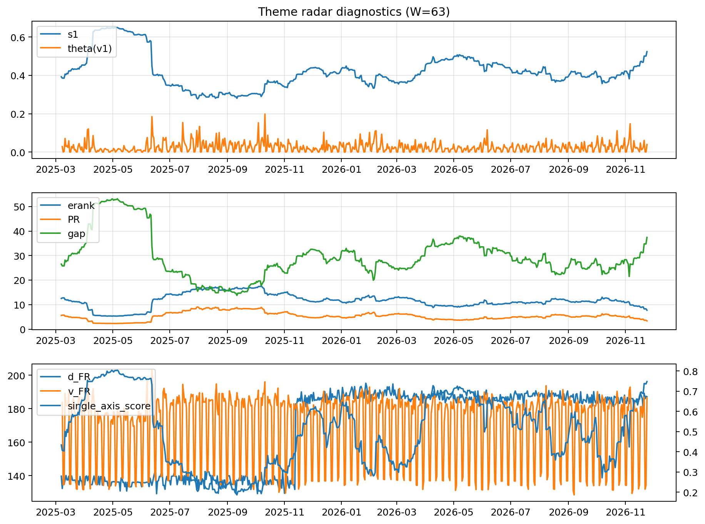

# Theme Radar Daily Brief — 2026-11-24

## Leaders (v1) — W=63
- **Nuclear_Uranium** (0.079044062986923)
- Semis (0.0701397706775244)
- Space (0.0550735760312365)

## Challengers — W=63
**v2:** Rates (0.1035038010909752), Metals (0.0769204793395247), Semis (0.0606618321903718)
**v3:** Rates (0.1191596026196489), MegaCap_AI (0.0905760250005745), Nuclear_Uranium (0.0864561781341388)

## Migration (20D slope) — W=63
**Top risers:**
- axis_Rates: 0.0005069232503662
- axis_Drones_Autonomy: 0.0004491944296355
- axis_Software_Cloud: 0.0003516857510329
- axis_Cyber: 0.0002822829238366
- axis_Defense: 0.0002669522856004
- axis_Sector_Comm: 0.0002288086332806
- axis_Sector_Materials: 0.0001919561042427
- axis_Sector_Health: 0.0001621182416561
- axis_Sector_Fin: 0.0001539203156466
- axis_MegaCap_AI: 0.0001353739872507

**Top fallers:**
- axis_Robotics: -0.0001481043301879
- axis_Space: -0.0001614163063701
- axis_Sector_Energy: -0.0001657270804134
- axis_Sector_ConsStap: -0.000169114489126
- axis_Equity_US: -0.0001834365769033
- axis_Credit: -0.0001864426606621
- axis_Genomics_Bio: -0.0002807874207508
- axis_Quantum: -0.000281376743502
- axis_Commodities: -0.0003236806788002
- axis_Semis: -0.0003479417232536

## Risk line (W=63)
- s1: 0.5237320581781036
- theta_v1: 0.0393994463620512
- v_FR: 186.5619102748712
- single_axis_score: 0.7474522292993631

## Interpretation
**Regime:** `theme_migration`

- Action: Tomorrow watchlist: Rates, Drones_Autonomy, Software_Cloud, Cyber, Defense + v2_top1=Rates
- Action: Hedge note: normal correlation stability.

- Percentiles (W=63 history): vfr_pct=0.86, theta_pct=0.78, s1_pct=0.89, score_pct=0.89.

---
**BUNDLE_ROOT_SHA256:** `2e4984f1d720b17b17bff6d31547a429cf57e54a35d513770cd7aaa8a8a45693`
