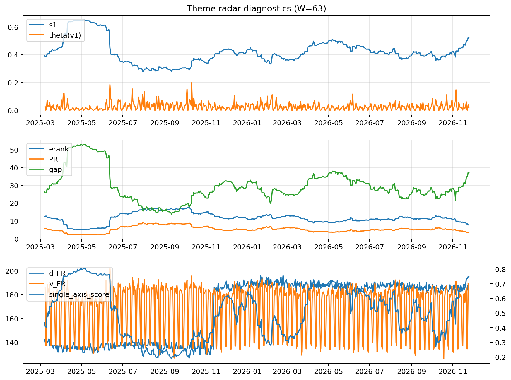

# Theme Radar Daily Brief — 2026-11-25

## Leaders (v1) — W=63
- **Nuclear_Uranium** (0.0796284317766432)
- Semis (0.0701436494348002)
- Space (0.0553258724786933)

## Challengers — W=63
**v2:** Rates (0.1023133108462663), Metals (0.0704257410708367), Semis (0.0612038862887897)
**v3:** Rates (0.1176868434925506), MegaCap_AI (0.0915619693301572), Nuclear_Uranium (0.0856461994365321)

## Migration (20D slope) — W=63
**Top risers:**
- axis_Rates: 0.0005706954367069
- axis_Drones_Autonomy: 0.0003491451922408
- axis_Software_Cloud: 0.0003281553880806
- axis_Metals: 0.0002528186230728
- axis_Sector_Comm: 0.0002518590396653
- axis_Cyber: 0.0002279244383139
- axis_Defense: 0.0001960865214737
- axis_MegaCap_AI: 0.0001761923251583
- axis_Sector_Materials: 0.0001616467654771
- axis_Sector_Fin: 0.0001357418276673

**Top fallers:**
- axis_Sector_ConsStap: -0.000128619912685
- axis_DataCenter_Infra: -0.0001481390559575
- axis_Robotics: -0.0001483638346973
- axis_Credit: -0.0001684834362312
- axis_Space: -0.0001844165098471
- axis_Equity_US: -0.000195597091526
- axis_Quantum: -0.0002657305914111
- axis_Commodities: -0.0003209101524421
- axis_Semis: -0.0004101321880876
- axis_Genomics_Bio: -0.0004428007417699

## Risk line (W=63)
- s1: 0.5207510420725386
- theta_v1: 0.0201248543740548
- v_FR: 175.72428444040332
- single_axis_score: 0.7453100158982513

## Interpretation
**Regime:** `theme_migration`

- Action: Tomorrow watchlist: Rates, Drones_Autonomy, Software_Cloud, Metals, Sector_Comm + v2_top1=Rates
- Action: Hedge note: normal correlation stability.

- Percentiles (W=63 history): vfr_pct=0.35, theta_pct=0.50, s1_pct=0.89, score_pct=0.89.

---
**BUNDLE_ROOT_SHA256:** `f0411b9a26830542579972296119589f2cfc138f530afe4d8e9130d69bad6127`
