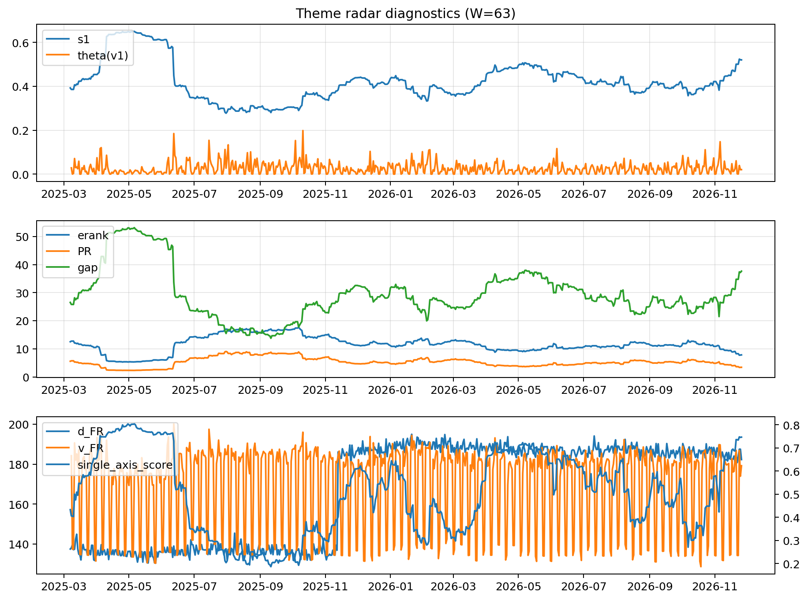

# Theme Radar Daily Brief — 2026-11-26

## Leaders (v1) — W=63
- **Nuclear_Uranium** (0.0794950440103956)
- Semis (0.070229667290702)
- Space (0.0554257173159105)

## Challengers — W=63
**v2:** Rates (0.0996262015845754), Metals (0.071127502695963), Semis (0.0633036478513598)
**v3:** Rates (0.1221911252030146), MegaCap_AI (0.0971850236464262), Nuclear_Uranium (0.0900451934916254)

## Migration (20D slope) — W=63
**Top risers:**
- axis_Rates: 0.0006898153880675
- axis_Software_Cloud: 0.0003515435743002
- axis_Drones_Autonomy: 0.000313939031406
- axis_Metals: 0.0002588716455616
- axis_Sector_Comm: 0.0002531512806993
- axis_Cyber: 0.0002316346691913
- axis_MegaCap_AI: 0.0002153970900265
- axis_Defense: 0.0001822910757066
- axis_Sector_Materials: 0.0001743726190987
- axis_Sector_Fin: 0.0001499556261845

**Top fallers:**
- axis_Sector_ConsStap: -0.0001234879633547
- axis_DataCenter_Infra: -0.0001402992149159
- axis_Robotics: -0.0001564294615826
- axis_Space: -0.0001812709137195
- axis_Credit: -0.0001955795940487
- axis_Equity_US: -0.0002044361052856
- axis_Quantum: -0.0002390843969645
- axis_Commodities: -0.0003398464063018
- axis_Semis: -0.000406035036596
- axis_Genomics_Bio: -0.0005306190367051

## Risk line (W=63)
- s1: 0.5202387679370912
- theta_v1: 0.0205413815791625
- v_FR: 179.1995097779859
- single_axis_score: 0.7463492063492063

## Interpretation
**Regime:** `theme_migration`

- Action: Tomorrow watchlist: Rates, Software_Cloud, Drones_Autonomy, Metals, Sector_Comm + v2_top1=Rates
- Action: Hedge note: normal correlation stability.

- Percentiles (W=63 history): vfr_pct=0.44, theta_pct=0.51, s1_pct=0.89, score_pct=0.89.

---
**BUNDLE_ROOT_SHA256:** `9cd409f01e0448d9fd2595161b3164001bb918c705b03fb2439051bb30a134a2`
