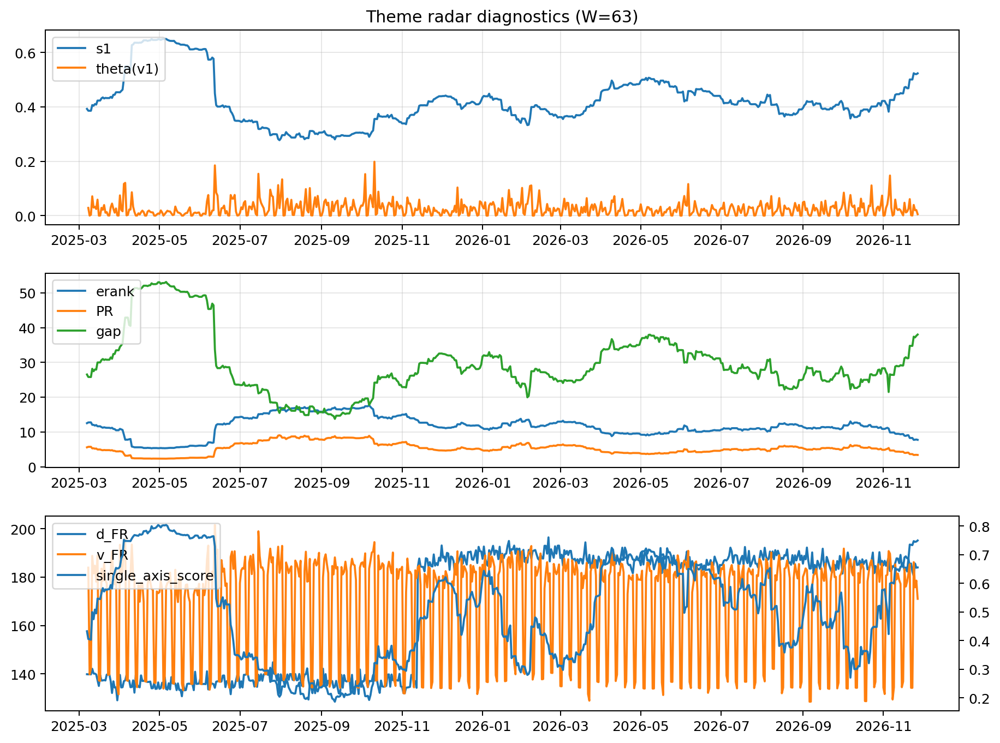

# Theme Radar Daily Brief — 2026-11-27

## Leaders (v1) — W=63
- **Nuclear_Uranium** (0.079506343460784)
- Semis (0.0700480433888069)
- Space (0.0555216877742263)

## Challengers — W=63
**v2:** Rates (0.0984104226630851), Metals (0.0732220098060516), Semis (0.0643503778679421)
**v3:** Rates (0.1263592239198143), MegaCap_AI (0.096998856991121), Nuclear_Uranium (0.0893037950561571)

## Migration (20D slope) — W=63
**Top risers:**
- axis_Rates: 0.0008042736067012
- axis_Software_Cloud: 0.000353792654016
- axis_Drones_Autonomy: 0.0002904192308538
- axis_Sector_Comm: 0.0002519895179325
- axis_Metals: 0.0002440768139848
- axis_MegaCap_AI: 0.000243316255143
- axis_Cyber: 0.0002201777682816
- axis_Defense: 0.0001745589352274
- axis_Sector_Materials: 0.0001738919811567
- axis_Sector_Fin: 0.0001530883571059

**Top fallers:**
- axis_Sector_ConsStap: -0.0001063265193813
- axis_DataCenter_Infra: -0.0001322714577201
- axis_Robotics: -0.0001582805824288
- axis_Space: -0.000167520446971
- axis_Equity_US: -0.000209670716991
- axis_Quantum: -0.0002186802196907
- axis_Credit: -0.0002286328719126
- axis_Commodities: -0.0003567136118295
- axis_Semis: -0.0003741787998854
- axis_Genomics_Bio: -0.0005927408736434

## Risk line (W=63)
- s1: 0.523235851491328
- theta_v1: 0.0052096985336407
- v_FR: 171.03697608812027
- single_axis_score: 0.7492868462757528

## Interpretation
**Regime:** `theme_migration`

- Action: Tomorrow watchlist: Rates, Software_Cloud, Drones_Autonomy, Sector_Comm, Metals + v2_top1=Rates
- Action: Hedge note: normal correlation stability.

- Percentiles (W=63 history): vfr_pct=0.29, theta_pct=0.28, s1_pct=0.89, score_pct=0.90.

---
**BUNDLE_ROOT_SHA256:** `d012303dc4c06c5edb1a754e7861fbf3d618700636f648a362c67f5097b43a2b`
