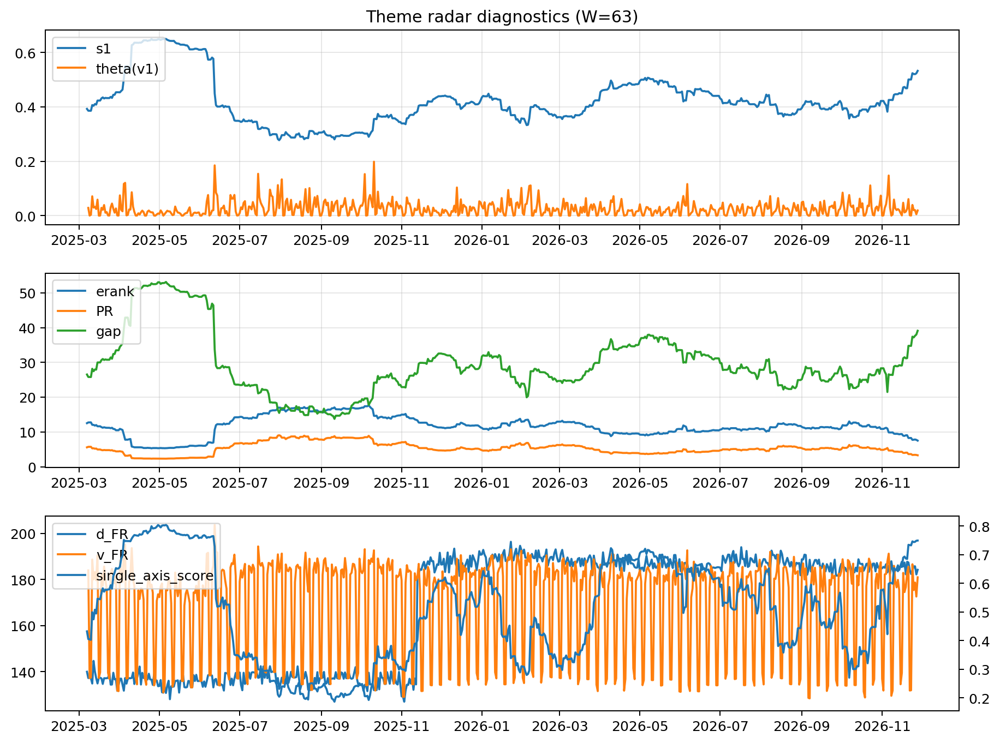

# Theme Radar Daily Brief — 2026-11-28

## Leaders (v1) — W=63
- **Nuclear_Uranium** (0.079267924921707)
- Semis (0.0694393685897624)
- Space (0.0554032502761426)

## Challengers — W=63
**v2:** Rates (0.0984566172060337), Metals (0.0698940494887943), Semis (0.0649431779282465)
**v3:** Rates (0.1284780684359351), MegaCap_AI (0.0971729107490947), Nuclear_Uranium (0.0895423567547045)

## Migration (20D slope) — W=63
**Top risers:**
- axis_Rates: 0.0009242290657818
- axis_Software_Cloud: 0.0003536265654408
- axis_MegaCap_AI: 0.00026915815782
- axis_Drones_Autonomy: 0.0002636208249478
- axis_Sector_Comm: 0.0002479478035381
- axis_Metals: 0.0002349154041046
- axis_Cyber: 0.0002120265874927
- axis_Sector_Materials: 0.0001706366083098
- axis_Defense: 0.000162489764008
- axis_Sector_Fin: 0.0001530127469064

**Top fallers:**
- axis_DataCenter_Infra: -0.0001261343891173
- axis_Nuclear_Uranium: -0.000149448221416
- axis_Space: -0.0001496882556935
- axis_Robotics: -0.0001584892072013
- axis_Quantum: -0.0001956856738572
- axis_Equity_US: -0.0002138712602674
- axis_Credit: -0.0002630322276357
- axis_Semis: -0.0003389665639152
- axis_Commodities: -0.0003755189340108
- axis_Genomics_Bio: -0.0006522765249309

## Risk line (W=63)
- s1: 0.532470506946476
- theta_v1: 0.0190201368811131
- v_FR: 180.93287266961065
- single_axis_score: 0.7490506329113924

## Interpretation
**Regime:** `theme_migration`

- Action: Tomorrow watchlist: Rates, Software_Cloud, MegaCap_AI, Drones_Autonomy, Sector_Comm + v2_top1=Rates
- Action: Hedge note: normal correlation stability.

- Percentiles (W=63 history): vfr_pct=0.52, theta_pct=0.48, s1_pct=0.89, score_pct=0.90.

---
**BUNDLE_ROOT_SHA256:** `1118c0089343445229249e6e9121afdfa23e135b033034d64f5291d47cd2b19b`
